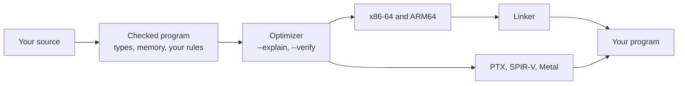

<a href="https://suidvandiewereld.github.io/Mettle/"></a>

**Mettle is a systems language with its own optimizer, linker, runtime and debugger.** It compiles to native code for x86-64 and ARM64, and to PTX, SPIR-V and Metal for GPUs.

[Website](https://suidvandiewereld.github.io/Mettle/) | [Getting started](docs/getting-started.md) | [Documentation](docs/README.md) | [What does not work yet](docs/known-limitations.md)

## Faster than llama.cpp, on the same card

[Systm](https://systm.co.za/)'s Potentia runs LLMs on Mettle.

- **2.4× faster to the first token.** 35.7 ms against 87.1 ms.
- **1.41× faster writing code.** 140.5 against 99.3 tokens a second.
- **12× less memory after four users.** 1.8 GB against 21.5 GB.
- **38% less energy per token at eight requests.** 0.38 J against 0.61 J.

Its GPU kernels are Mettle, compiled straight to PTX with no nvcc, C++ or Python in the pipeline. The build fails unless the GPU matches an independent CPU reference, logit for logit.

<sub>Gemma 4, QAT Q4_0, on one RTX 5060 Ti, against llama.cpp from LM Studio with every layer on the GPU and one engine in VRAM at a time. First token: 12B, a 128-token prompt. Code: 12B, with Gemma 4's assistant drafter in both engines. Memory: 26B-A4B, RAM right after four users.</sub>

You get the same language. Here is what it lets you do.

## Install

Linux:

```bash
curl -fsSL https://raw.githubusercontent.com/The-Mettle-Project/Mettle/main/install.sh | sh
```

Windows, in PowerShell:

```powershell
irm https://raw.githubusercontent.com/The-Mettle-Project/Mettle/main/install.ps1 | iex
```

Neither needs root or admin. Both install v0.17.0, the latest release. Live programs, rules, effects, target descriptions, invented machines and Metal are newer: until the next release, [build from source](#build-from-source) to use them.

```mettle
import "std/io";

fn main() -> int32 {
  println("hello");
  return 0;
}
```

```bash
mettle --build hello.mettle
```

## Change it while it runs

Run a program under `mettle live` and every save becomes a patch. It keeps its state, and every frame on the stack moves to the new code. If it crashes, it waits for your fix.

```text
1500000 records, 122784319 dollars settled
Fatal error: array index out of bounds (index 9001, length 64)
  --> settle.mettle:34:32 in post
⋯
[live] main stopped at the fault. Save a fix and it continues from its last quiesce point
Patch 1: post (2304 bytes)
⋯
[live] main continues from its last quiesce point
record 1500000 held: merchant 9001 does not exist
2000000 records, 163680452 dollars settled
```

The program adds one line, `quiesce;`, where it may change. Add a struct field and save, and every value on the heap converts in place. Undo it, and they convert back. A live build runs within 0.7% of a normal one, as a geometric mean over eight programs at `-O`, on Windows x64 and Linux x64. [Live programs](docs/live.md)

## Program the GPU directly

A kernel is a Mettle function. It compiles straight to PTX or Metal, and one line launches it.

```mettle
kernel(block = 256) vadd(a: float32*, b: float32*, c: float32*, n: int32) {
  var i: int32 = block.x * block_dim.x + thread.x;
  if (i < n) {
    c[i] = a[i] + b[i];
  }
}

dispatch vadd[work: n](da, db, dc, n);
```

[GPU offload](docs/gpu.md)

## Make the compiler obey

Put `@simd!` on a loop and it vectorizes, or the build stops and tells you why. `@inline!` and `@noalloc` work the same way.

```mettle
@simd! fn checksum(data: uint8*, n: int64) -> int64 {
  var sum: int64 = 0;
  for i: int64 in 0..n {
    if (data[i] == 0) { break; }
```

```text
error: @simd! loop was not vectorized: the loop body branches on data (an `if` or `&&`/`||` per iteration); only straight-line loop bodies vectorize
```

## Make it explain itself

`--explain` names the instruction it chose, the loop it gave up on, and what it took on trust.

```text
checksum (loop @ line 6): vectorized -> vpsadbw, 32-wide byte sum (AVX2)
main (loop @ line 15): NOT vectorized  [store-only-fill]
main (call to `checksum` @ line 17): inlined
⋯
10 things this build took on trust.
⋯
```

`--verify` runs every optimizer pass on the same inputs before and after, and hands you a runnable counterexample if they differ. [Compilation](docs/compilation.md), [translation validation](docs/translation-validation.md)

## Write your own laws

A rule is a function you write. It runs in the compiler over your program, and when it fails, the build stops at the line it names.

```mettle
@rule fn no_recursion(p: Program) -> Verdict {
  for f in p.functions {
    if (f.module == "" && f.is_recursive) {
      return verdict_fail(f.site, "this module forbids recursion");
```

```text
error[R0002]: rule 'no_recursion' failed: this module forbids recursion
```

A type can carry a predicate, and a value becomes one only where the compiler proves it. A function can forbid an effect across its whole call graph, or bound its own longest path in cycles. [Rules](docs/rules.md), [effects](docs/effects.md), [types](docs/types.md)

## Never write a lifetime

The compiler reads the whole program and tells you what it can prove: use after free, double free, leaks, dangling returns. You mark nothing, and for a warning like this one the call stays yours.

```mettle
var data: uint8* = malloc(n);
free(data);
println("checksum = {checksum(data, n)}");
```

```text
warning[M0101]: Use of `data` after it was freed (freed at line 17); this is use-after-free
Built executable 'checksum.exe'
```

When you want run-time checks too, `--safe` checks every memory access and proves away what it can. [Memory analyser](docs/borrow-checker.md), [checked access](docs/memory-safety.md)

## Redefine the machine

A target is a Mettle value. Print one, change what you like, and build for it. Here the argument registers run backwards, and the code follows.

```text
$ mettle target x86_64-none > mine.mettle
int_args: ["r9", "r8", "rcx", "rdx", "rsi", "rdi"],

$ mettle add.mettle --target mine.mettle --emit-obj -o add.o
mov rdx, r9
mov rax, r8
mov rbx, rcx
```

You can also describe an instruction set in a Mettle file. The compiler checks it, assembles your program for it, and runs it with `mettle emulate`. [Bare metal](docs/bare-metal.md)

## How it fits together

Everything runs in one process, from your source to the executable.



[Architecture](docs/ARCHITECTURE.md), [Mettle and libmtlc](docs/mettle-and-libmtlc.md)

## Where it runs

Windows and Linux on x86-64 share one source tree and one test suite. Each owns its runtime: Windows links its own PE images, and Linux emits ELF and makes its own system calls. AArch64 is proven under an emulator. [macOS and Metal](docs/macos.md) have run on an M4 Pro, though `main` does not build there right now. [Bare metal](docs/bare-metal.md) lists what ran each claim.

## Build from source

The whole toolchain lives in this repository, and the build runs offline.

Windows, with gcc or clang:

```powershell
.\build.bat
.\tests\run_tests.ps1
```

Linux:

```bash
make -j"$(nproc)"
make check
```

`make check` needs [PowerShell Core](https://aka.ms/powershell). [Contributing](CONTRIBUTING.md) covers the rest, and editor extensions live in [MettleMisc](https://github.com/The-Mettle-Project/MettleMisc).

## License

Apache 2.0. See [LICENSE](LICENSE).
