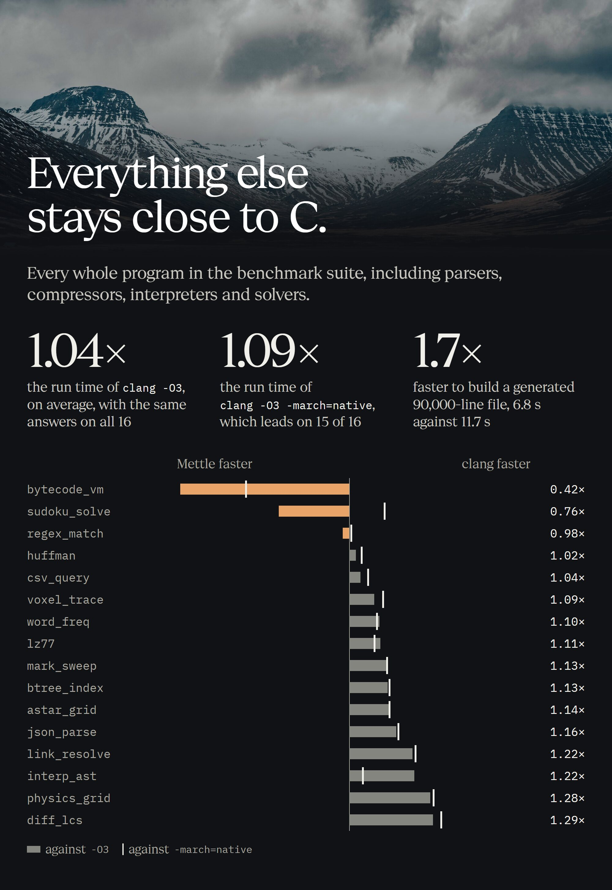

<a href="https://suidvandiewereld.github.io/Mettle/"></a>

**Mettle is a systems language with its own optimizer, linker, runtime and debugger.** It compiles to native code for x86-64 and ARM64, and to PTX, SPIR-V and Metal for GPUs.


<sub>[Systm](https://systm.co.za/)'s Potentia against llama.cpp from LM Studio, on Gemma 4 12B and 26B-A4B, QAT Q4_0, on one RTX 5060 Ti, with every layer on the GPU and one engine in VRAM at a time. Energy is board joules per token. At 16 requests, throughput is 473 against 446 tokens a second.</sub>



<details>
<summary>All 16 programs</summary>

| Program | Against `-O3` | Against `-march=native` |
|---|---:|---:|
| `bytecode_vm` | 0.71× | 1.06× |
| `sudoku_solve` | 0.82× | 1.21× |
| `huffman` | 1.00× | 1.05× |
| `regex_match` | 1.02× | 1.04× |
| `voxel_trace` | 1.10× | 1.09× |
| `lz77` | 1.11× | 1.10× |
| `word_freq` | 1.11× | 1.08× |
| `mark_sweep` | 1.11× | 1.07× |
| `astar_grid` | 1.11× | 1.08× |
| `interp_ast` | 1.16× | 1.01× |
| `diff_lcs` | 1.20× | 1.23× |
| `btree_index` | 1.21× | 1.17× |
| `csv_query` | 1.22× | 1.17× |
| `link_resolve` | 1.24× | 1.27× |
| `json_parse` | 1.26× | 1.28× |
| `physics_grid` | 1.29× | 1.27× |

</details>

<sub>clang 22.1.6 on Windows, on an i7-12700K, best of 15 pinned runs. Under `-march=native`, clang's physics_grid returns a different checksum. Run them with `tools/benchmark/mc.ps1 -Suite 3`.</sub>


- **Change it while it runs.** Save a file and the running program takes the new code, even after a crash. [Live programs](docs/live.md)
- **Program the GPU directly.** A kernel is a Mettle function, compiled straight to PTX or Metal. [GPU offload](docs/gpu.md)
- **Make the compiler obey.** Put `@simd!` on a loop and it vectorizes, or the build stops and tells you why.
- **Make it explain itself.** `--explain` names what it did with every loop and call, and what it took on trust. [Compilation](docs/compilation.md)
- **Write your own laws.** A rule is a function you write that runs in the compiler and can stop the build. [Rules](docs/rules.md)
- **Never write a lifetime.** It reads the whole program and tells you what it can prove. [Memory analyser](docs/borrow-checker.md)
- **Redefine the machine.** Print a target as Mettle, change it and build for it, or invent an instruction set and run on it. [Bare metal](docs/bare-metal.md)

```mettle
@simd! fn checksum(data: uint8*, n: int64) -> int64 {
  var sum: int64 = 0;
  for i: int64 in 0..n {
    sum = sum + (int64)data[i];
  }
  return sum;
}
```

```text
checksum (loop @ line 6): vectorized -> vpsadbw, 32-wide byte sum (AVX2)
```


```bash
curl -fsSL https://raw.githubusercontent.com/The-Mettle-Project/Mettle/main/install.sh | sh
```

```powershell
irm https://raw.githubusercontent.com/The-Mettle-Project/Mettle/main/install.ps1 | iex
```

These install v0.17.0. Live programs, rules, target descriptions and Metal are newer, so until the next release, build them from source with `make -j"$(nproc)"` on Linux or `.\build.bat` on Windows.

[Getting started](docs/getting-started.md) | [Documentation](docs/README.md) | [What does not work yet](docs/known-limitations.md) | [Contributing](CONTRIBUTING.md)

<sub>Apache 2.0. Photos by Ryan Shroyer, Raul Ling, Susanne Jutzeler and Julia Volk on Pexels.</sub>
