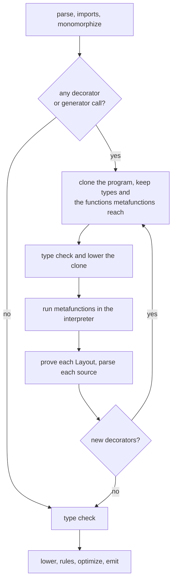
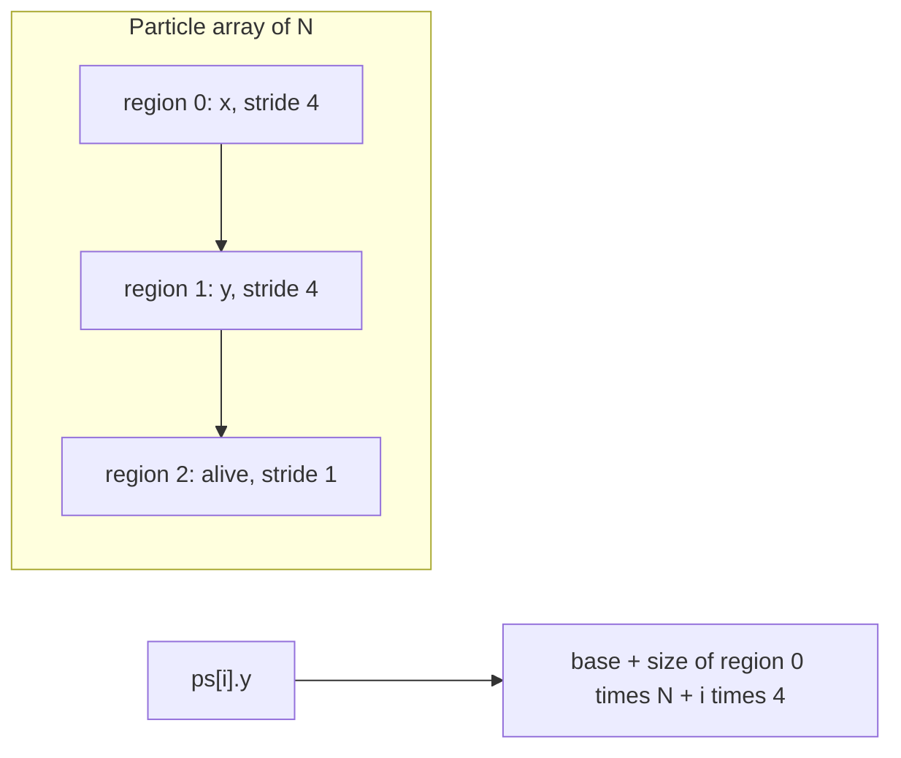
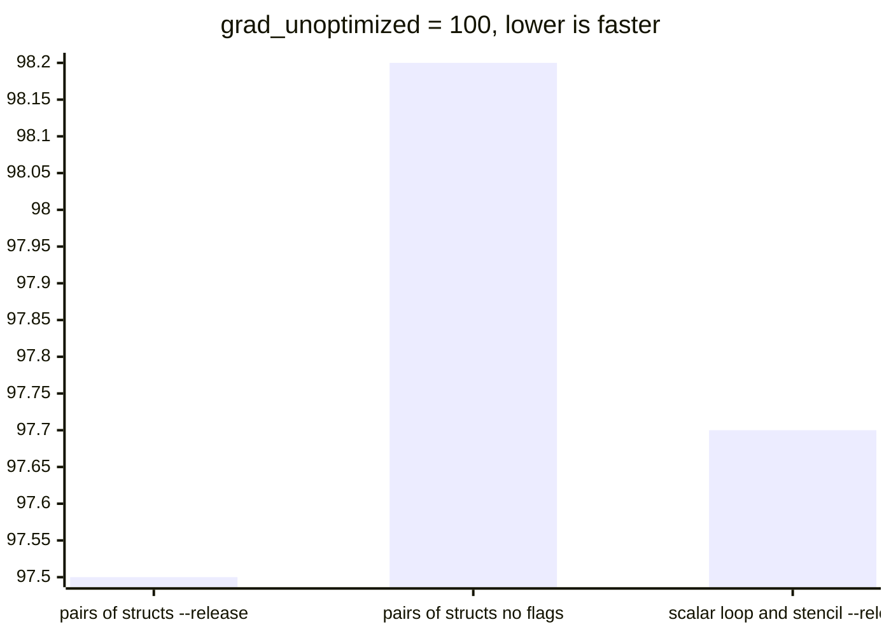
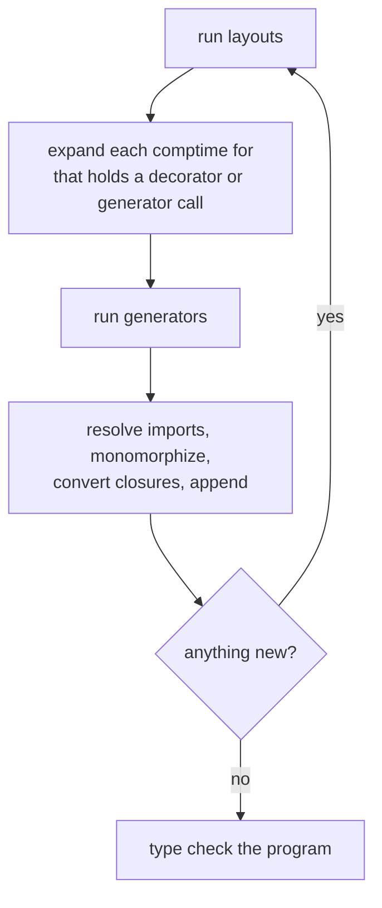

# Metaobject protocol

Struct layout, field access, allocation, dispatch and generated functions are
decided by Mettle functions that run while compiling. A library can write `@soa`,
hot/cold splitting, tagged pointers, its own vtables, `@memoize`, tracing and
`grad(f)`, and the code they produce goes through the same checks as code you
typed.

A metafunction returns one of two things:

- A `Layout`, which is data. The compiler generates every access from it.
- Mettle source text. The compiler parses it and checks it with the program.

Neither can produce something `mettle expand` cannot print.

## Stages

A metafunction has to run before the type checker can finish, and the
interpreter runs on lowered IR. So the compiler builds the metaprogram first, as
a smaller program, and runs it.



A program with no decorator pays for one walk over its declarations.

A metafunction may not reach a type whose layout depends on it. That is a cycle
and the build stops with the chain printed.

Metafunctions are dropped from the final program like rules, and normal code
cannot call them.

## Layouts

```mettle
import "std/layout";

@soa struct Particle {
  x: float32;
  y: float32;
  alive: bool;
}

fn total(ps: Particle[]) -> float32 {
  var sum: float32 = 0.0;
  for i in 0..ps.length { sum = sum + ps[i].x; }
  return sum;
}
```

`@soa` is a function in `std/layout`:

```mettle
@layout fn soa(t: TypeInfo, l: Layout) -> Layout { ... }
```

A layout function takes the type and the layout so far, plus the decorator's
arguments as `string[]` if it declares them. Stacked decorators run in order, and
the first one receives the default layout.

A `Layout` holds regions and places. A region is a run of bytes per element, with
a stride and an alignment. A place says where one field lives: its region and
offset, and for a packed field its word size, bit offset, bit width and left
shift.



The compiler proves a layout before it uses one. Every field has one place, no
two places share a bit, every place fits its region's stride, every byte place
sits at its field's alignment, and a packed value fits its width. That is a proof
over intervals, so no probing is involved. A layout that fails stops the build
with `L0002` at the struct.

What a layout means for the rest of the language:

- A lone value keeps its regions next to each other, so `sizeof`, `&p`, by-value
  calls and `p.x` work with one offset per field. `T[N]` takes the size the
  regions need for N elements.
- With more than one region, `a[i].f` needs the element count. Fixed arrays have
  it and slices carry it. Indexing a `T*` or doing arithmetic on one stops the
  build with `L0003`, because a thin pointer has no count. `new T[n]` already
  returns a slice.
- `&a[i]` has no address under more than one region and stops with `L0003`.
  `&a[i].f` is a plain pointer into a column. Reading or writing a whole `a[i]`
  copies field by field.
- A packed field has no address, and `&p.f` stops with `L0003`. Its type stays
  what you wrote, so the borrow analyser and effects see a `Node*` where a tagged
  `Node*` is stored. Loads and stores become shift and mask.
- `extern` signatures and GPU kernels read memory by C rules, so a custom layout
  crossing either stops with `L0004`.
- The live descriptor prints the regions and places, so conversion between two
  layouts works through the same field names as every other struct.

## Allocation

A `Layout` may name an allocator, `fn(bytes: int64, align: int64) -> rawptr`, which
returns zeroed memory, and a releaser, `fn(p: rawptr)`. `new T` and `new T[n]` call
the allocator and `free` on a `T*` calls the releaser. The compiler checks the
allocator's signature at each `new`.

## Generators

```mettle
@generate fn memoize(f: FunctionInfo) -> Generated { ... }

@memoize fn fib(n: int64) -> int64 { ... }
```

A generator returns Mettle source. With a decorator on a function, the compiler
renames the original to `f.inner_name`, so the source can define the original name
and call it. `grad(f)` is an ordinary call to a generator: the call site becomes
the name the `Generated` value carries.

`FunctionInfo` holds the signature, the locals and temporaries with their types,
every function it reaches, the structs those hold, and the body as a structured
tree: code, `if`, `loop`, `block`, `break`, `continue` and `return`. The tree
comes through the structurizer the Metal backend uses, so an irreducible function
is refused by name. `std/meta` prints the tree back as Mettle.

`@generate` reads the IR as lowered. `@generate(optimized)` reads it after the
whole optimizer ran on the target and everything it reaches, in a stage build of
its own. What the optimizer leaves is spelled in scalar operations before the
generator sees it: `select` and `rotate_add` become branches and assigns, each
SIMD kernel becomes the loop it stands for, and the names SSA leaves behind stay
as locals. So `render_function` and `grad` have one vocabulary. `f.kernels` lists
what was spelled. `simd_matmul_n32`, `inline_asm` and anything else with no scalar
form is refused by name, in the operation's own words.

`grad` reads optimized code. It builds the same tape either way, and on the same
inputs the two return the same bits. Pinned minimums on three loop-heavy
functions, optimized against `grad_unoptimized`:



The cost is 13% more compile time on the first of those and a 4.6% larger binary.

Parsed source runs through the type checker, borrow analysis, effects and
contracts like anything else. Each generated function records which decorator
wrote it, and `mettle expand` prints that above it. Diagnostics in generated code
point into the generated source.

Each round's output goes through the import resolver and the monomorphizer before
it joins the program. The resolver keeps the set of files it already merged, so a
generated import of a module the program holds adds nothing. The monomorphizer
keeps the generic definitions, traits and impls it removed from the program, so
generated code can instantiate a generic the program wrote and the program can
instantiate a generic a generator wrote. An instantiation already in the program
is dropped.



A module-scope `comptime for` that names a type or table no round has written yet
is left out of that round's stage build and tried again in the next. The type
checker expands what is left, and reports anything still unknown by name. A
`comptime for` expanded early records its sequence and iteration on the
declarations it makes, so every later stage build and the final type check bind
the same names to their own types. If a stage build fails for the whole list of
generators, each generator runs alone, so one that needs another's output waits
for the next round.

## Gradients through memory

A float temporary carries its tape node in a shadow local. Memory carries nodes in
a table keyed by address, which a store and a load update. A struct passed by
value lands at a new address, so the differentiated function takes the caller's
address as an extra argument and copies the table entries for the struct's bytes
on entry. A returned struct names its address in `ad_return_address`, and the
caller copies from there straight after the call. A zeroing or integer store
clears the entries it overwrites, so a stale node from an earlier frame cannot
reach a fresh local.

## Checks on generated code

A generator states what it promises by writing a `@rule` with its code. The rule
calls the original and the generated function in the interpreter on probe inputs,
so the check runs on every build under the rule budget and never reaches the
binary. `grad` compares against finite differences, `@memoize` walks the call
graph for global writes and undeclared externs and compares results, and `@trace`
compares results.

A generator that writes no rule gets `L0005` as a warning naming it.

## Dispatch

A trait's vtable scheme is a generator on the trait. `@dyn trait Shape { ... }`
writes a fat pointer type, one table per implementation and the forwarding
functions as source. A table is a `const`, and `devirtualize_known_tables` turns a
call through a table it can trace within a block into a direct call.

## Costs

`--report-meta` prints the layouts, generators, source bytes, stage builds and
interpreter steps, and `--meta-budget=N` stops the build past N steps.

## Error codes

- `L0001`: a metafunction could not run, or it returned something unreadable.
- `L0002`: a layout failed its proof.
- `L0003`: an operation needs an address or a count the layout does not have.
- `L0004`: a custom layout crossed `extern` or a kernel.
- `L0005`: a generator stated no relation.
- `L0006`: a metafunction reaches a type whose layout depends on it.
