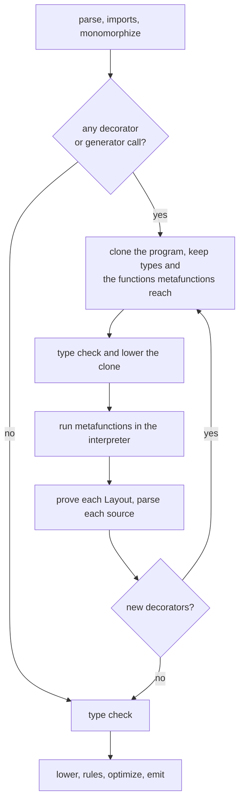
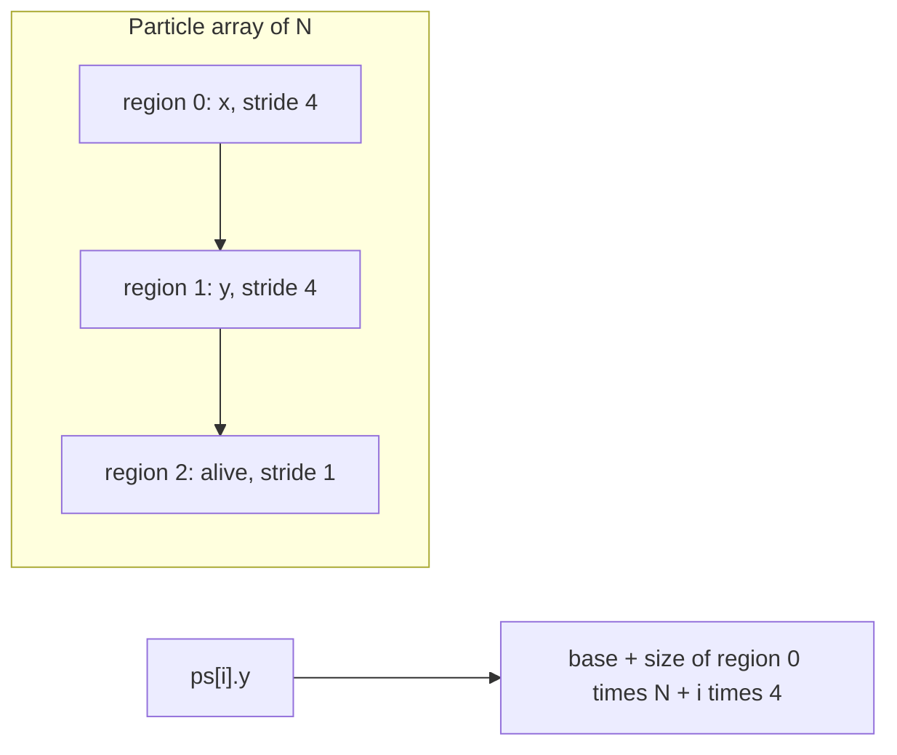

# Metaobject protocol

Struct layout, field access, allocation, dispatch and generated functions are
decided by Mettle functions that run while compiling. A library can write `@soa`,
hot/cold splitting, tagged pointers, its own vtables, `@memoize`, tracing and
`grad(f)`, and the code they produce goes through the same checks as code you
typed.

A metafunction returns one of two things:

- A `Layout`, which is data. The compiler generates every access from it.
- Mettle source text. The compiler parses it and checks it with the program.

Neither can produce something `mettle expand` cannot print.

## Stages

A metafunction has to run before the type checker can finish, and the
interpreter runs on lowered IR. So the compiler builds the metaprogram first, as
a smaller program, and runs it.



A program with no decorator pays for one walk over its declarations.

A metafunction may not reach a type whose layout depends on it. That is a cycle
and the build stops with the chain printed.

Metafunctions are dropped from the final program like rules, and normal code
cannot call them.

## Layouts

```mettle
import "std/layout";

@soa struct Particle {
  x: float32;
  y: float32;
  alive: bool;
}

fn total(ps: Particle[]) -> float32 {
  var sum: float32 = 0.0;
  for i in 0..ps.length { sum = sum + ps[i].x; }
  return sum;
}
```

`@soa` is a function in `std/layout`:

```mettle
@layout fn soa(t: TypeInfo, l: Layout) -> Layout { ... }
```

A layout function takes the type and the layout so far, plus the decorator's
arguments as `string[]` if it declares them. Stacked decorators run in order, and
the first one receives the default layout.

A `Layout` holds regions and places. A region is a run of bytes per element, with
a stride and an alignment. A place says where one field lives: its region and
offset, and for a packed field its word size, bit offset, bit width and left
shift.



The compiler proves a layout before it uses one. Every field has one place, no
two places share a bit, every place fits its region's stride, every byte place
sits at its field's alignment, and a packed value fits its width. That is a proof
over intervals, so no probing is involved. A layout that fails stops the build
with `L0002` at the struct.

What a layout means for the rest of the language:

- A lone value keeps its regions next to each other, so `sizeof`, `&p`, by-value
  calls and `p.x` work with one offset per field. `T[N]` takes the size the
  regions need for N elements.
- With more than one region, `a[i].f` needs the element count. Fixed arrays have
  it and slices carry it. Indexing a `T*` or doing arithmetic on one stops the
  build with `L0003`, because a thin pointer has no count. `new T[n]` already
  returns a slice.
- `&a[i]` has no address under more than one region and stops with `L0003`.
  `&a[i].f` is a plain pointer into a column. Reading or writing a whole `a[i]`
  copies field by field.
- A packed field has no address, and `&p.f` stops with `L0003`. Its type stays
  what you wrote, so the borrow analyser and effects see a `Node*` where a tagged
  `Node*` is stored. Loads and stores become shift and mask.
- `extern` signatures and GPU kernels read memory by C rules, so a custom layout
  crossing either stops with `L0004`.
- The live descriptor prints the regions and places, so conversion between two
  layouts works through the same field names as every other struct.

## Allocation

A `Layout` may name an allocator, a Mettle function
`fn(bytes: int64, align: int64) -> cstring`. `new T` and `new T[n]` call it. A
layout with no allocator uses the program's allocator.

## Generators

```mettle
@generate fn memoize(f: FunctionInfo) -> string { ... }

@memoize fn fib(n: int64) -> int64 { ... }
```

A generator returns Mettle source. With a decorator on a function, the compiler
renames the original to `name__inner`, so the source can define `name` and call
it. `grad(f)` is an ordinary call to a generator: the call site becomes the name
of the function the source defines, which `std/meta` spells `generated_name`.

`FunctionInfo` holds the signature, the inferred effects and purity, and the body
as a structured tree: `block`, `loop`, `if`, `br`, `return` and instructions. The
tree comes from the lowered IR with Ramsey's dominator tree structuring, so any
function the compiler lowered has one, and an irreducible one is refused by name.
`std/meta` renders the tree back to Mettle.

Parsed source runs through the type checker, borrow analysis, effects, contracts
and the expansion ledger. Generated source carries a note naming the decorator
that wrote it, and `mettle expand` prints it.

## Checks on generated code

A generator states what it promises by emitting a `@rule` along with its code. The
rule calls the original and the generated function in the interpreter on probe
inputs, so the check runs on every build under the rule budget and never reaches
the binary. `grad` compares against finite differences, `@memoize` needs inferred
purity and equal results, and trace needs equal results.

A generator that emits no rule gets `L0005` as a warning naming it, and `--explain`
lists it among the beliefs.

## Dispatch

A trait's vtable scheme is a generator on the trait. `@dyn trait Shape { ... }`
emits a fat pointer type, one table per implementation and the forwarding methods
as source. A table is a `const`, so a call through a known table folds to a direct
call.

## Costs

Every metafunction reports its interpreter steps and every generator the nodes it
produced, through `--report-meta` and the budget `--meta-budget=N`.

## Error codes

- `L0001`: a metafunction could not run, or it returned something unreadable.
- `L0002`: a layout failed its proof.
- `L0003`: an operation needs an address or a count the layout does not have.
- `L0004`: a custom layout crossed `extern` or a kernel.
- `L0005`: a generator stated no relation.
- `L0006`: a metafunction reaches a type whose layout depends on it.
