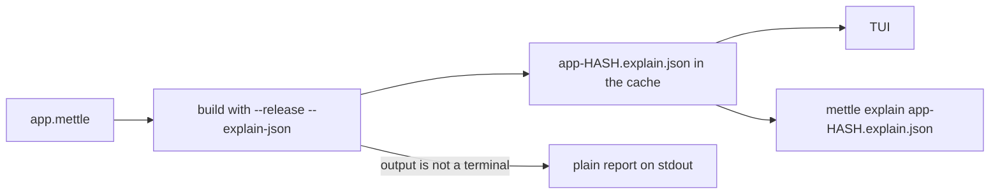

# mettle explain

`mettle explain` builds a file with `--release` and opens what the compiler did
with it as a terminal UI: every optimizer decision with its reason and the fix
it proved, every drop and move the compiler inserted, the bounds checks that
survived, the cost of each function, what the types proved, what the build
took on trust, and what each pass changed.

```bash
mettle explain app.mettle
mettle explain app.mettle --safe --target x86_64-linux
```

Flags after the file are build flags, so the report describes the build you
would get with them.



## Tabs

1. **Overview**: the totals, the fixes worth making first, and what changed
   since the last run. Enter on a fix opens its loop in Optimizer.
2. **Optimizer**: every loop and call by function, with the verdict, the reason
   it declined, the fix, and whether the fix was applied to a copy of the
   function and re-checked.
3. **Ownership**: each drop the compiler inserted, each drop you wrote, each
   move and each live bit, with the Mettle it wrote out and what that lowered
   to. [Ownership](ownership.md) has the rules.
4. **Memory**: memory diagnostics, and under `--safe` the bounds checks that
   stayed and why each one did.
5. **Functions**: every function by cost, with instruction counts, loops,
   registers, spills, its callers and callees, and the cost model per loop.
6. **Proofs**: bounds checks a declared type removed, optimizations a type
   earned, conversions proven, effects checked, rules run, layout facts, and
   every belief the build did not check.
7. **Passes**: what each optimizer pass removed and where.

The detail pane shows the selected entry, the source lines it is about, and the
long explanation for its code, the same text `mettle explain <code>` prints.

## Keys

- left and right, Tab and Shift+Tab, or 1 to 7: switch tabs
- up and down or j and k: move, or scroll the detail
- PgUp, PgDn, Home, End: page, first, last
- Enter: open the detail, or follow a link
- s: the whole source file at this line
- Esc or Backspace: back
- /: filter by any text in an entry
- m, f, a: missed only, with a fix only, all
- ?: help
- q: quit

The mouse wheel scrolls the pane under the pointer, and a click selects a tab
or an entry.

## Saved reports

Each run keeps its object, its JSON report and its baseline in the cache:
`METTLE_CACHE`, or `%LOCALAPPDATA%\Mettle\cache`, `$XDG_CACHE_HOME/mettle` or
`~/.cache/mettle`, under `explain/`. The baseline is what the Overview compares
against on the next run.

`mettle explain` also opens any `.explain.json`, including one a build wrote
with `--explain-json`:

```bash
mettle --release --explain-json --build app.mettle -o app.exe
mettle explain app.explain.json
```

## Without a terminal

When the output is not a terminal, `mettle explain app.mettle` prints the plain
report on stdout, the same text `--release --explain` prints during a build.
`--text` prints a saved report the same way.

`--screen=COLUMNSxROWS` runs the TUI against a virtual terminal of that size
and prints the last frame, and `--keys` feeds it keys first:

```bash
mettle explain app.mettle --screen=120x40 --keys="2 / text:hoist enter"
```

Keys are separated by spaces: a single character, `up`, `down`, `left`,
`right`, `pgup`, `pgdn`, `home`, `end`, `enter`, `esc`, `tab`, `backtab`,
`bksp`, `space`, `wheelup`, `wheeldown`, `click:X,Y`, `resize:WxH`, or
`text:` followed by characters to type. The suite drives every tab this way.

## See also

- [Compilation](compilation.md): `--explain` during a build
- [The --explain-json schema](explain-json.md)
- [Ownership](ownership.md)
