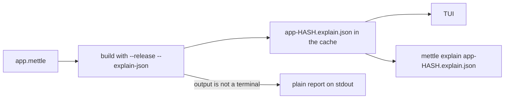
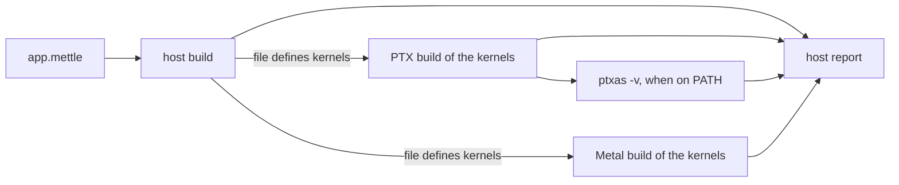

# mettle explain

`mettle explain` builds a file with `--release` and opens what the compiler did
with it as a terminal UI: every optimizer decision with its reason and the fix
it proved, every drop and move the compiler inserted, the bounds checks that
survived, the cost of each function, what the types proved, what the build
took on trust, what each pass changed, and the machine code each line became.

```bash
mettle explain app.mettle
mettle explain app.mettle --safe --target x86_64-linux
```

Flags after the file are build flags, so the report describes the build you
would get with them.



## Tabs

1. **Overview**: the totals, the fixes worth making first, the hottest loops
   by their share of the static loop cost, and what changed since the last
   run. Enter on any of them opens the loop in Optimizer.
2. **Optimizer**: every loop and call by function, with the verdict, the reason
   it declined, the fix, and whether the fix was applied to a copy of the
   function and re-checked. A call outside every loop that stays a call reads
   "kept as a call" and does not count as a miss. Code inlined into another
   function is listed under the function that wrote it, with the host named. A scalar loop shows its cycles per iteration and
   the port that bounds it. A vectorized loop shows its vector body, the
   instructions of one pass, and what a pass costs: the larger of the front
   end's four instructions a cycle, two loads, one store, the floating point
   and integer vector ports, and port 5 for shuffles. When the pointer the
   body advances agrees with the lane count, it also gives the cost of one
   element.
3. **Ownership**: one entry per owned value, a local, a parameter, a match
   payload or a temporary, with its whole life on one line: where it moves,
   where the old value is freed on reassignment, and where it is freed for
   good. The detail names the source line of every move and every free, the
   live bit that guards a value that moves on some paths only, what its drop
   runs, and the function as the compiler rewrote it, with each inserted line
   marked `+`. Drop glue gets an entry per type, listing what dropping one
   runs. [Ownership](ownership.md) has the rules.
4. **Memory**: memory diagnostics, and under `--safe` the bounds checks that
   stayed and why each one did.
5. **Functions**: every function by cost, with instruction counts, loops,
   registers, spills, its callers and callees, and the cost model per loop.
6. **Proofs**: bounds checks a declared type removed, optimizations a type
   earned, conversions proven, effects checked, rules run, layout facts, and
   every belief the build did not check.
7. **Passes**: what each optimizer pass removed and where.
8. **Kernels**: one entry per kernel and target, with where its values live,
   what its accesses became, its workgroup memory, the device calls it kept,
   and the figures the target's own compiler measured. [GPU programs](#gpu-programs)
   has the detail.

The detail pane shows the selected entry, the source lines it is about, the
machine code those lines became, and the long explanation for its code, the
same text `mettle explain <code>` prints.

## Machine code

Every entry that points at a line shows the instructions the backend emitted
for it, decoded from the bytes in the object file. For a loop it shows the
machine loop itself, found from its back edge. This is the saxpy loop from
`tests/explain_demo.mettle`:

```text
Machine code  saxpy, lines 12 to 13: 70 instructions, 9 vector, 55 in a kernel
        the machine loop, 9 instructions:
    af                vmovups ymm0, [rcx]
    b4                vmovups ymm1, [rdx]
    b9                vmulps ymm0, ymm0, ymm4
    be                vfmadd231ps ymm0, ymm5, ymm1
    c3                vmovups [rdx], ymm0
    c8                add rcx, 32
    cc                add rdx, 32
    d0                cmp rcx, r11
    d3                jb 0xaf
```

Each row is the byte offset in the function, the cost model's reciprocal
throughput in cycles with the ports it charges, and the instruction in Intel
syntax. Vector kernel instructions are highlighted, and the cost model does
not price them. `d` opens the whole function with each source line above the
instructions it became, scrolled to the entry; code inlined from another file
is marked with the file and line it came from.

[`examples/raii_demo`](../examples/raii_demo/raii_demo.mettle) is a radar
track file written to fill every tab. Its tracks own heap trails, so the
Ownership tab has every kind of life: a match payload that moves on two paths
and is freed on the third behind a live bit, a string rebuilt every pass of a
loop, a trail replaced each iteration, a parameter freed on return, a pop whose
result is never stored, and the drop glue that runs `Track.drop` and then frees
the trail. Under `--safe` the
Memory tab lists each bounds check that stayed, grouped by function, beside a
planted constant overflow:

```bash
mettle explain examples/raii_demo/raii_demo.mettle --safe
```

## GPU programs

A file that defines kernels is compiled for the GPU as well, and the report
covers both halves. The host half is the program without its kernels: a
`dispatch` shows as its own entry with the work items and blocks the compiler
could fold, and the runtime's launch calls do not appear. The device half is
compiled once for PTX and once for Metal, since both emitters run on any
machine. The optimizer's remarks about the kernels print once, because both
targets share that pipeline, and each target then gets a device report.



`--gpu-provider=cuda` or `--gpu-provider=metal` keeps one target. A file with
kernels and no `main` has no host half, and the report is the two device
reports.

```bash
mettle explain tests/gpu/explain_device.mettle
```

```text
-- device report, PTX 8.8 for sm_121a: explain_device.mettle -------------------
  measured by ptxas 12.9; warps are the most that fit on one multiprocessor
  window_sum (kernel @ line 5, block 64): 12 registers a thread, a 56 byte stack frame, all 48 warps fit
      \_ values: 2 in local memory (52 bytes)
  window_sum (array `window` @ line 8): in local memory, 36 bytes  [local-memory]
       8 | var window: float32[9];
      \_ reason: lines 9 and 11 index it with values that are not constants, so its elements cannot each take a register
  quad_sum (kernel @ line 17, block 32): 14 registers a thread, 24 of 48 warps fit, limited by the block size
      \_ memory: 1 vector load in place of 4 separate loads
  pair_sum (kernel @ line 22, block 32): 10 registers a thread, 24 of 48 warps fit, limited by the block size
  pair_sum (2 adjacent loads from `rows` @ line 23): kept as separate loads  [vector-load-alignment]
      23 | out[thread.x] = rows[0] + rows[1];
      \_ reason: the pointer's type declares no alignment, and one load of 2 elements needs 8 bytes
      \_ fix: declare `align(8)` in the pointer's type
```

A kernel takes one line: its name, its block, and the figures `ptxas -v`
measured for it. A second line follows only when the kernel has one of these:

- **Values**: arrays and records that stayed in memory. Each one is then listed
  with the lines that kept it there. A value that ends in a register is not
  listed, whichever way the emitter wrote it: where ptxas gives the kernel no
  stack frame, the report counts its values as register values.
- **Memory**: loads and stores that go through the generic path, and the vector
  loads a declared alignment formed.
- **Workgroup memory**: the bytes a block holds, or an arena sized at launch.
- **Calls**: the helpers that stayed device calls.

Tensor operations and staged copies are listed under their kernel with the
instruction each became: `mma.sync` or `wmma.mma` on PTX, `simdgroup_matrix`
tiles on Metal, `cp.async` for a staged copy. Kernels a target has nothing to
say about share one closing line, `nothing to report for quad_sum, pair_sum`.

In the viewer the Kernels tab is the same report as a table: one row per
kernel, with the registers a thread, the warps that fit, and a count of the
entries in the Optimizer tab that are worth a look. The Optimizer tab lists a
kernel's missed optimizations only. A miss both targets report is one entry
with a line for each target.

A decision the optimizer declined is listed with the reason and a fix. The fix
is printed only when applying it to a copy of the kernel makes the optimization
happen:

```text
  accumulate (tensor MMA loop @ line 60): NOT resident: every pass loads and stores the accumulator  [tensor-observable]
      60 | tensor_mma(a + inner, b + inner, d, d,
      \_ reason: line 64 calls `atomic_store_u32`, which could read or write the accumulator
      \_ fix: move line 64 out of the loop
      \_ verified: without that line the accumulator stays in registers across the loop
```

A construct one target refuses does not stop the report. The other target's
kernels are reported, and the refusing target shows the reason:

```text
-- device report, Metal: hardware_kernels.mettle -------------------------------
  the kernels in this file do not build for Metal
      \_ reason: Metal has no 64-bit atomic read-modify-write that returns a value: 'atomic_litmus' calls atomic_add_u64; ...
```

The detail of a kernel entry shows the code the emitter wrote for the selected
line, PTX or Metal Shading Language, and `d` opens the whole kernel with each
source line above the device code it became. `t` switches that code to the
other target. Device code carries no cycle cost: the driver compiles it again,
so the measured figures are the ones the target's compiler reports.

The same report prints during a device build:

```bash
mettle --release --explain --emit-ptx kernels.mettle -o kernels.ptx
mettle --release --explain --emit-metal kernels.mettle -o kernels.metal
```

## Keys

- left and right, Tab and Shift+Tab, or 1 to 8: switch tabs
- up and down or j and k: move, or scroll the detail
- PgUp, PgDn, Home, End: page, first, last
- Enter: open the detail, or follow a link
- s: the whole source file at this line
- d: the machine code of the whole function at this line
- t: a kernel's device code on the other GPU target
- e: the whole function as the compiler rewrote it, with every inserted drop,
  defer and temporary marked `+`
- Esc or Backspace: back
- /: filter by any text in an entry
- m, f, a: missed only, with a fix only, all
- ?: help
- q: quit

The mouse wheel scrolls the pane under the pointer, and a click selects a tab
or an entry.

## Saved reports

Each run keeps its object, its JSON report and its baseline in the cache:
`METTLE_CACHE`, or `%LOCALAPPDATA%\Mettle\cache`, `$XDG_CACHE_HOME/mettle` or
`~/.cache/mettle`, under `explain/`. The baseline is what the Overview compares
against on the next run.

`mettle explain` also opens any `.explain.json`, including one a build wrote
with `--explain-json`:

```bash
mettle --release --explain-json --build app.mettle -o app.exe
mettle explain app.explain.json
```

## Without a terminal

When the output is not a terminal, `mettle explain app.mettle` prints the plain
report on stdout, the same text `--release --explain` prints during a build.
`--text` prints a saved report the same way.

`--screen=COLUMNSxROWS` runs the TUI against a virtual terminal of that size
and prints the last frame, and `--keys` feeds it keys first:

```bash
mettle explain app.mettle --screen=120x40 --keys="2 / text:hoist enter"
```

Keys are separated by spaces: a single character, `up`, `down`, `left`,
`right`, `pgup`, `pgdn`, `home`, `end`, `enter`, `esc`, `tab`, `backtab`,
`bksp`, `space`, `wheelup`, `wheeldown`, `click:X,Y`, `resize:WxH`, or
`text:` followed by characters to type. The suite drives every tab this way.

## See also

- [Compilation](compilation.md): `--explain` during a build
- [The --explain-json schema](explain-json.md)
- [Ownership](ownership.md)
