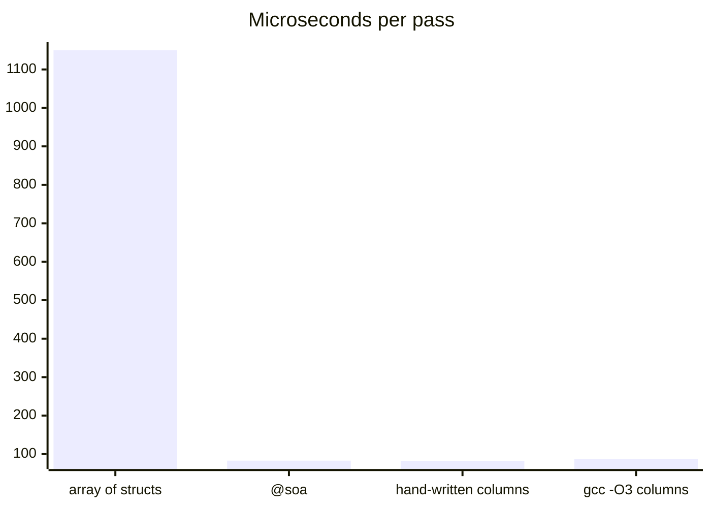
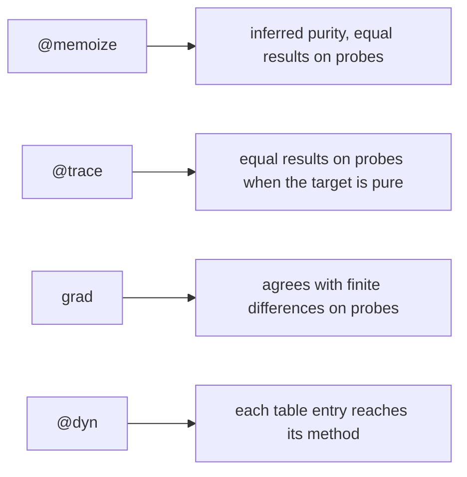

# Metaprogramming

A metafunction is a Mettle function that runs while compiling and decides
something the compiler would otherwise decide alone: where a struct's fields
live, how its objects are allocated, or what code a declaration turns into.

The compiler builds the metafunctions first, as a small program of their own,
and runs them in the interpreter. What they return goes through the same checks
as code you typed. `mettle expand` prints all of it as Mettle.

[The design](design/metaobject.md) covers the stages and the checks.

## Layouts

```mettle
import "std/layout";

@soa struct Particle {
  x: float32;
  y: float32;
  alive: bool;
}

fn total(ps: Particle[]) -> float32 {
  var sum: float32 = 0.0;
  for i in 0..ps.length { sum = sum + ps[i].x; }
  return sum;
}
```

`std/layout` ships these:

- `@soa` gives each field its own column.
- `@hot_cold(a, b)` keeps the named fields in one region and the rest in another.
- `@compact` orders fields by alignment so the padding goes away.
- `@tagged(next, kind, 3)` stores `kind` in the low 3 bits of the pointer `next`.
- `@allocate_with(take, give)` names the functions `new` and `free` call.

They stack, and each one receives the layout so far:

```mettle
@soa @allocate_with(pool_take, pool_give) struct Sample { ... }
```

A loop over one `@soa` column compiles to the loop a hand-written array gets.
Summing one field of 1048576 records:



### Writing one

```mettle
@layout fn nibbles(t: TypeInfo, l: Layout) -> Layout {
  var out: Layout;
  out.regions = new Region[1];
  out.regions[0].stride = 4;
  out.regions[0].align = 4;
  out.places = new Place[t.fields.length];
  for i in 0..t.fields.length {
    out.places[i].field = t.fields[i].name;
    out.places[i].word = 4;
    out.places[i].bit = i * 8;
    out.places[i].width = 8;
  }
  return out;
}
```

A `Region` is a run of bytes per element. A `Place` says where a field lives: its
region and offset, and for a packed field its word size, bit offset, bit width
and left shift. Add a third parameter `args: string[]` to read decorator
arguments.

The compiler proves the result before using it. A place outside its stride, two
fields sharing a bit, or a broken alignment stops the build with `L0002`, naming
the field.

### What a layout changes

More than one region means an element has no single address, so `T*` holds the
base, the index and the count, 24 bytes in all:

```mettle
fn bump(p: P*) { p.y = p.y + 1.0; }

var a: P[8];
bump(&a[3]);

var e: P* = &a[0];
e[2].x = 1;
e = e + 1;
```

- `a[i].f` works on arrays and slices, which carry the element count.
- `&a[i]` and `new T` make a `T*`. `e.f`, `*e`, `e[i]`, `e + n`, `e - f`, `==`,
  `free(e)` and `e->method()` work as on any pointer.
- `&a[i].f` is a plain pointer into the column.
- `x = a[i]` and `a[i] = x` copy region by region.
- `new T[n]` returns a slice, as it does for every type.
- `@hot_cold(key, next)` works on a node with a `next: Node*`. Allocate with `new`
  and take `&a[i]`. `var e: T* = malloc(n)` and `(T*)p` stop with `L0003`, because
  a bare pointer has no count.

Debug and `--safe` builds check the index against the count on every access, and
`--release` drops the check.

A packed field has no address, so `&p.f` stops with `L0003`. Its type stays what
you wrote, so the borrow analyser and effects read a tagged `Node*` as a `Node*`.

A custom layout cannot cross `extern` or reach a GPU kernel, because both read
memory by the default rules. That stops with `L0004`. Copy into a default struct
at the border.

A running program converts to and from custom layouts. Adding `@soa` to a global
or a heap array in a live patch moves its elements into columns in place, and
undo moves them back. Thin pointers to that type become references and return to
thin pointers on undo. A type that names its own allocator is refused, because
the running program does not know where its values are.

## Generators

```mettle
import "std/meta";

@memoize fn fib(n: int64) -> int64 {
  if (n < 2) { return n; }
  return fib(n - 1) + fib(n - 2);
}

@trace fn add(a: int32, b: int32) -> int32 {
  return a + b;
}

fn loss(x: float64, y: float64) -> float64 {
  return x * x * y + sin(y);
}

fn main() -> int32 {
  var g: loss__gradient = grad(loss)(2.0, 3.0);
  println("{g.value} {g.d_x} {g.d_y}");
  return 0;
}
```

`std/meta` ships these:

- `@memoize` caches results in a table.
- `@trace` reports each entry and exit.
- `grad(f)` is reverse-mode differentiation. Slices of floats are differentiated
  element by element. A struct passed by value gets a gradient of the same type,
  so `grad(f)(s, t).d_s.a.x` is the derivative with respect to `s.a.x`.
- `@dyn` on a trait writes a fat pointer type, one table per implementation and
  the forwarding functions.

`@dyn trait Shape` gives you `Shape__dyn` and `Shape__from_Circle(&c)`. A call
through a table the optimizer can see is a direct call.

### Writing one

```mettle
@generate fn logged(f: FunctionInfo) -> Generated {
  var t: Text;
  text_add(&t, "{signature_text(f.name, f)} {{\n");
  text_add(&t, "  println(\"{f.name}\");\n");
  text_add(&t, "  return {f.inner_name}({arguments_text(f)});\n}\n");
  return generated_as(f.name, text_done(&t));
}
```

A generator returns Mettle source. On a decorated function, the compiler renames
the original to `f.inner_name`, so the source defines `f.name` and calls it. A
call like `grad(loss)` becomes the name in `generated_as`. Decorators stack, and
the one nearest the function runs first.

The target comes as a `FunctionInfo` for a function, a `TypeInfo` for a struct and
a `TraitInfo` for a trait. `FunctionInfo` holds the signature and the body as a
structured tree over the IR. `render_function` prints that tree back as Mettle,
and a generator can walk it to write something else, which is how `grad` works.
`refuse(why)` stops the build with your reason.

`@generate(optimized) fn g(f: FunctionInfo)` reads the function after the
optimizer. Kernels and selects arrive spelled as loops and branches, and
`f.kernels` names the ones that were there. `grad` works this way.
`grad_unoptimized` reads the code as written.

Generated source is a file like any other. It can import modules and declare or
use generics, traits and closures. It can also hold `comptime for` and decorated
declarations. A `comptime for` can reflect on a struct a generator wrote, and a
`comptime for` body can hold a decorated function. The compiler keeps expanding
and generating until nothing new appears, 16 rounds at most.

### Stating what you promise

The interpreter can only check a generator if it knows what the output should do.
A generator says so by writing a `@rule` with its code:



These run on every build under `--rule-budget` and never reach the binary. A rule
checks the inputs it tries and no others. A generator with no rule gets `L0005` as
a warning naming it.

## Passes

```mettle
import "std/pass";

@pass(cleanup) fn double_as_shift(f: PassFunction) -> PassFunction {
  for i in 0..f.code.length {
    var op: PassOp = f.code[i];
    if (op.op == "binary" && op.text == "+" && !op.is_float &&
        op.lhs.kind == OPERAND_SYMBOL && op.rhs.kind == OPERAND_SYMBOL &&
        op.lhs.name == op.rhs.name) {
      f.code[i].text = "<<";
      f.code[i].rhs = operand_int(1);
    }
  }
  return f;
}
```

A pass receives one function's IR as a flat list of operations and returns the
list it wants. To add an operation, build a longer `code` with `new_op`. To drop
one, leave it out. It runs at `-O` and `--release`, once per function, at the point
it names: `pre_inline`, `fixpoint`, `loop_canonical`, `recognizers`, `cleanup`,
`ssa`, `end`, or `after_<pass>` for a built-in pass.

Every result runs against the old function on generated inputs. A pass that
changes what a function returns stops the build:

```text
tests\err_pass_changes_behavior.mettle:16:11: error[L0007]: pass 'wrong_doubling' changed what 'twice' does
  counterexample (input set 0) twice(5)
  divergence: return value was 10, is now 20
```

`mettle expand` prints each changed function as Mettle under the pass's name.

## Register allocation

```mettle
import "std/regalloc";

@regalloc fn mine(g: AllocGraph) -> Assignment {
  return chaitin_briggs(g);
}
```

A `@regalloc` function colours every function in the program. It reads each
vreg's allowed registers and neighbours and returns one register per vreg, or -1
to spill. A register outside the mask, or two live values in one register, stops
the build and names your function:

```text
error: '@one_register_for_all' wrote a wrong assignment: two entry-live values share a register at instruction 0 (v0, v1) in function 'add3'
```

## Costs

`--report-meta` prints what ran. `--meta-budget=N` stops the build when
metafunctions spend more than N interpreter steps. A program with no decorators
walks its declarations once and builds nothing.
