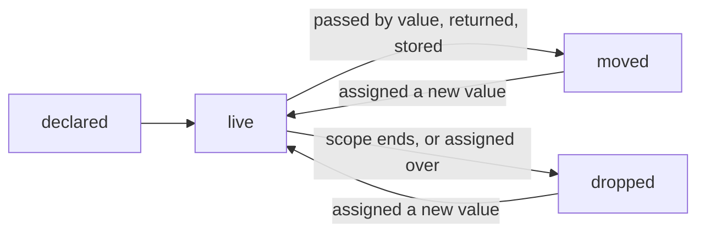
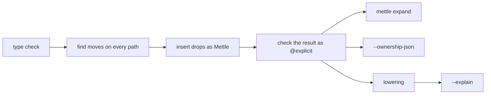

# Ownership

A value that owns a resource is dropped when its scope ends, on every path
out, unless it moved first. The compiler writes those drops in for you, the way
C++ runs destructors and Rust drops values. Every drop it writes and every move
it follows is recorded with where it came from, and you can read all of it:
`mettle expand` prints your source with the drops written out, `--explain`
lists them with what they compiled to, and the editor shows them inline.

Mark a function `@explicit` and the compiler writes nothing into it. Each place
it would have written a drop becomes an error that says what to write, and
`--fix` writes it. The program means the same thing either way.

## What owns a resource

A struct owns a resource when it has a `drop` method:

```mettle
struct File {
  fd: int64;

  method drop() {
    if (this.fd > 0) {
      file_close(this.fd - 1);
    }
  }
}
```

The free-function spelling is the pointer-receiver method, `fn
File_drop__ptr(self: File*)`, and a generic struct takes a generic one, `fn
List_drop__ptr<T>(items: List<T>*)`. A destructor takes its value through a
pointer and returns nothing. A by-value `T_drop` is an error (`O0011`).

Owning spreads outward. A struct with an owning field owns, a fixed array of
owning elements owns, and a tagged enum with an owning payload owns, so
`Option<File>` owns. Pointers, slices and strings own nothing: memory behind a
pointer belongs to whoever frees it.

A local declared without an initializer starts zeroed, and a zeroed value gets
dropped like any other. Write `drop` so that the zero value is safe to drop.
The `fd - 1` above is that rule at work: a zero `fd` means no file.

## Drops



The compiler inserts:

- `defer drop(x);` right after each owning local, so `x` is dropped when its
  scope ends, after anything deferred later and before anything deferred
  earlier.
- `defer drop(p);` at the top of a function for each owning parameter passed
  by value: the callee owns it.
- `defer drop(v);` at the top of a `match` arm that takes an owning payload.
- `drop(x);` before an assignment that replaces a live value. The new value is
  computed first, then the old one is dropped, then the new one is stored; when
  the right side calls anything, the compiler holds the new value in a local so
  that order is visible.
- `drop(f());` when a call returns an owning value and nothing keeps it.

Dropping a struct runs its own `drop` method first, then drops its owning
fields from last to first. Arrays drop their elements from last to first, and
an enum drops the payload of the variant it holds. That is generated as
ordinary functions named `__drop_` and the type, which `mettle expand` prints.

## Moves

A value moves when it is passed by value, returned, stored into a variable or
a field, put in a struct literal or an enum payload, or given to `drop` or
`forget`. A moved value is not dropped where it was, and using it afterwards is
an error (`O0001`) that names the line that moved it.

A struct field can move on its own when the struct has no `drop` method. The
rest of the struct is still dropped at the end of its scope, field by field.
A struct with a `drop` method needs every field when it is dropped, so moving
one out of it is an error (`O0003`).

Memory behind a pointer or an index belongs to something else, so a value
cannot move out of it (`O0009`). `mem_take(p)` moves the value out and leaves a
zero value behind; `mem_replace(p, value)` leaves the value you give it.

## Live bits

When a value moves on some paths and not others, the compiler cannot know at
the end of the scope whether it still holds anything:

```mettle
var d = open("log");
if (verbose) {
  keep(d);
}
```

It keeps a live bit for `d`: set when `d` gets a value, cleared when it moves.
The drop at the end of the scope runs only if the bit is set. Paths where the
answer is known at compile time read no bit; the bit is only used at exits
where it is needed. `mettle expand` and `--explain` name every live bit.

## Temporaries

A value that owns a resource and is used without a name, as in
`open(path).size`, is held in a compiler-named local until the statement ends
and dropped there. `mettle expand` shows the local. Anything the statement
evaluates before the temporary is held too, so nothing runs in a different
order.

A value matched on in `match` is held the same way while the arms run, so an
arm can take its payload.

## drop and forget

`drop(x)` runs `x`'s destructor and its fields' destructors and marks `x` gone.
`forget(x)` marks it gone and runs nothing; it is how a value is handed to code
that frees it some other way. Both are built in, so no function can take
either name (`O0012`). A destructor is never called by name (`O0007`): `drop`
does that and knows the value is gone afterwards.

`defer drop(x);` drops whatever `x` holds when the scope ends, so it sees a
reassignment, and it skips a value that has moved by then.

## @explicit

```mettle
@explicit fn copy_log(from: string, to: string) {
  var input = open(from);
  defer drop(input);
  var output = create(to);
  defer drop(output);
  pump(&input, &output);
}
```

An `@explicit` function gets no inserted drops. A value still owned when its
scope ends is an error (`O0020`), so is an assignment over a live value
(`O0021`), a discarded owning value (`O0022`) and an unnamed temporary
(`O0023`). Each error says what to write. `--fix` writes it, the way the
compiler would have:

```text
fix: copy.mettle:3: added `defer drop(input);` after this line
```

The fixed function and the implicit one compile to the same program, so
`@explicit` and implicit code call each other freely, and moving a function
from one to the other is mechanical. The compiler checks its own insertions
the same way: after writing the drops into implicit code, it runs the
`@explicit` check over the result and stops the build if a value is left
unaccounted for (`O0099`).

## Seeing what was inserted



`mettle expand file.mettle --focus` prints the file with every inserted drop
and its reason, a comment at each statement that moves a value, and a comment
at each `return`, `break`, `continue` and closing brace naming what is dropped
there:

```mettle
fn early(flag: bool) -> int32 {
    var a: Handle = make(40);
    // inserted: `a` owns a resource, so it is dropped when its scope ends, unless it has moved
    defer drop(a);
    if (flag) {
        // drops `a`
        return 1;
    }
    return 2;
}
```

`--explain` adds an ownership report: each drop with what it lowered to, such
as `1 call to File_drop__ptr, behind a live bit`, and whether the call was
still there after optimization or was inlined. `--annotate-asm` shows the
instructions at the line where the drop runs.

`--ownership-json` prints the same records as JSON and stops before code
generation. The VS Code extension uses it to show the inserted code at each
declaration, `moved` where a value moves, and what each exit drops, and offers
the `@explicit` fixes as quick fixes. `--fix-print` prints the fixed file
instead of writing it.

## Errors

- `O0001`: a value was used after it moved.
- `O0002`: a struct was used whole after a field moved out.
- `O0003`: a field moved out of a struct with a `drop` method.
- `O0004`: a move inside the right side of `&&` or `||`.
- `O0005`: `errdefer` dropped or moved an owned value.
- `O0006`: an assignment into part of a moved value.
- `O0007`: a destructor called by name.
- `O0008`: a move out of a global.
- `O0009`: a move out of memory behind a pointer or an index.
- `O0010`: an owning value declared in a `for` header.
- `O0011`: a destructor with the wrong shape.
- `O0012`: a function named `drop` or `forget`.
- `O0013`: a closure that captures an owning value.
- `O0014`: an owning value passed to a gathered `T[..]` parameter.
- `O0020` to `O0023`: what `@explicit` code is missing.
- `O0099`: the compiler's own insertions failed its check.

`mettle explain O0001` prints the long form of any of them.
