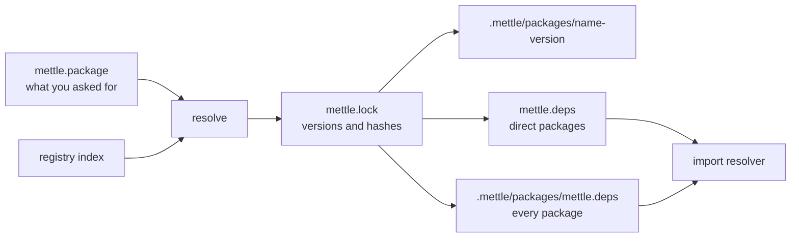
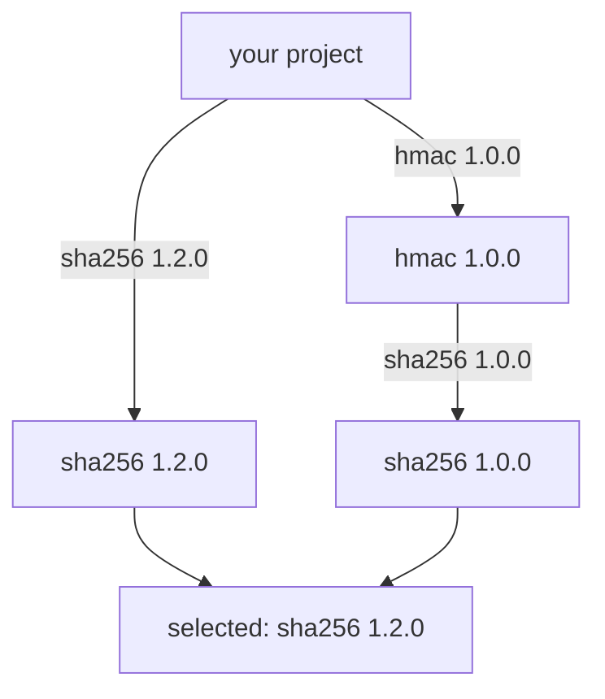

# Packages

`mettle pkg` installs packages from a registry of static files. The default
registry is on this project's GitHub Pages site, and its pages are at
[the-mettle-project.github.io/Mettle/registry](https://the-mettle-project.github.io/Mettle/registry/).

```bash
mettle pkg add json
```

```mettle
import "json";
```

## Commands

- `mettle pkg add <name>[@version]...` requires packages and installs them. With no
  version it takes the newest one this compiler can use.
- `mettle pkg remove <name>...` stops requiring packages and deletes what nothing
  needs any more.
- `mettle pkg install [--frozen]` installs what `mettle.lock` names.
- `mettle pkg update [name...]` raises requirements to the newest release of the same
  major version.
- `mettle pkg list` shows what this project resolved to.
- `mettle pkg search [text]` searches names and descriptions.
- `mettle pkg info <name>` shows a package's versions, hashes and requirements.
- `mettle pkg pack [dir] [-o file.tar]` checks a package and prints its files and hash.

Downloading needs `curl` on `PATH`. Windows 10 and later, macOS and most Linux
distributions ship it. A project whose archives are already in the cache installs
with no network.

## What it writes



- `mettle.package` names what the project requires. Commit it.
- `mettle.lock` names every package the project resolved to, with its SHA-256.
  Commit it.
- `mettle.deps` gets one line for each package the project requires directly. Lines
  you wrote yourself stay as they are.
- `.mettle/` holds the unpacked packages and ignores itself in git.

The compiler reads `mettle.deps` as it always has, walking up from the importing
file. A file in your project sees only the packages it requires. A file inside a
package also sees `.mettle/packages/mettle.deps`, which maps every resolved package.
Importing a package you only have indirectly fails until you add it.

`import "json";` loads `json.mettle` in the package's root, unless a file with that
name is beside the importer or in a `-I` directory: those win, so adding a package
never changes which file a program compiles. `import "json/number";` loads another
file in the package.

## Versions

A version is `MAJOR.MINOR.PATCH`. A requirement names the oldest version a project
or package works with:

```text
require = sha256 1.0.0
```

That means `1.0.0` or any newer `1.x.y`. The resolver walks the requirements and
picks the highest version anything names, for each package. It never picks a version
nobody named, so a new release changes nothing until someone asks for it.



Two major versions of one package cannot share a program. The resolver stops and
names both requirers.

## In CI

```bash
mettle pkg install --frozen
```

`--frozen` fails if `mettle.lock` does not match `mettle.package`. With or without
it, `install` hashes each archive and each unpacked folder against the lock, and
installs again if a file on disk changed. If the registry reports a different hash
for a locked version, it stops and says so.

## Environment

- `METTLE_REGISTRY` is the registry's address, ending in `/v1`, or a local
  directory holding the same files.
- `METTLE_CACHE` is where archives are kept, by hash. The default is
  `%LOCALAPPDATA%\Mettle\cache` on Windows and `~/.cache/mettle` elsewhere.

## Publishing

A package is a folder:

```text
mylib/
  mettle.package
  mylib.mettle
  LICENSE
  README.md
```

```text
name = mylib
version = 1.0.0
description = One line on what it does
license = MIT
source = https://github.com/you/mylib
compiler = 0.17.0
require = sha256 1.0.0
```

`name`, `version`, `description` and `license` are required. `compiler` is the oldest
mettle the package works with. Names are lower case letters, digits and underscores,
starting with a letter.

A package holds source. Paths use letters, digits, `_`, `-`, `.` and `+`. Files whose
names start with a dot are left out. Binaries, archives and links are refused, and
the limit is 16 MiB. `README.md` appears on the package's page, along with the
signature of everything it exports. Put `@test` functions in the source.

Check it, then add it to a clone of this repository and open a pull request:

```bash
mettle pkg pack mylib
```

```bash
python website/registry.py add path/to/mylib
```

```bash
python website/registry.py check --compiler bin/mettle
```

`add` copies the folder to `website/registry/packages/mylib/1.0.0/` and records its
hash in `website/registry/packages/mylib/versions`. CI then:

1. Hashes every version and compares it with its line in `versions`.
2. Refuses any change to a version published on the base commit.
3. Packs every version with the compiler and with the generator, and compares the
   bytes.
4. Installs the newest version of each package through `mettle pkg` over HTTP,
   compiles a program that imports it, and runs its `@test` functions.

The merge deploys the package with the rest of the site.

## Yanking

A published version never changes and never goes away. To stop new projects picking
one:

```bash
python website/registry.py yank mylib 1.0.0
```

`add` and `update` skip a yanked version. A project that already requires it still
installs it, with a warning.

## The registry's files

Everything is a static file, so any host that serves files can run a registry:

```text
registry/
  v1/index.txt
  v1/index.json
  v1/packages/<name>.txt
  v1/archives/<name>-<version>.tar
```

`python website/registry.py build --out <dir>` writes them, along with the HTML pages.
`index.json` is for tools. The `.txt` files are for the compiler: a header line, then
tab-separated records:

```text
mettle-registry-1
name	hmac
description	HMAC-SHA-256 from RFC 2104
release	1.0.0	<sha256>	<size>	<compiler or ->	<live or yanked>	<name@version,... or ->
```

An archive is an uncompressed ustar file with one exact form, so a folder has one
hash on every machine: files sorted by path, mode `0644`, owner `0`, time `0`,
regular files only, and two zero blocks at the end. Any `tar` reads it, and `sha256sum`
gives the hash in the lock.

The hash chain starts at the index, which comes over TLS from the host. Trust in the
registry's own contents rests on the review of the pull request that added them, and
`mettle.lock` protects a project from any later change. Archives are not signed.
