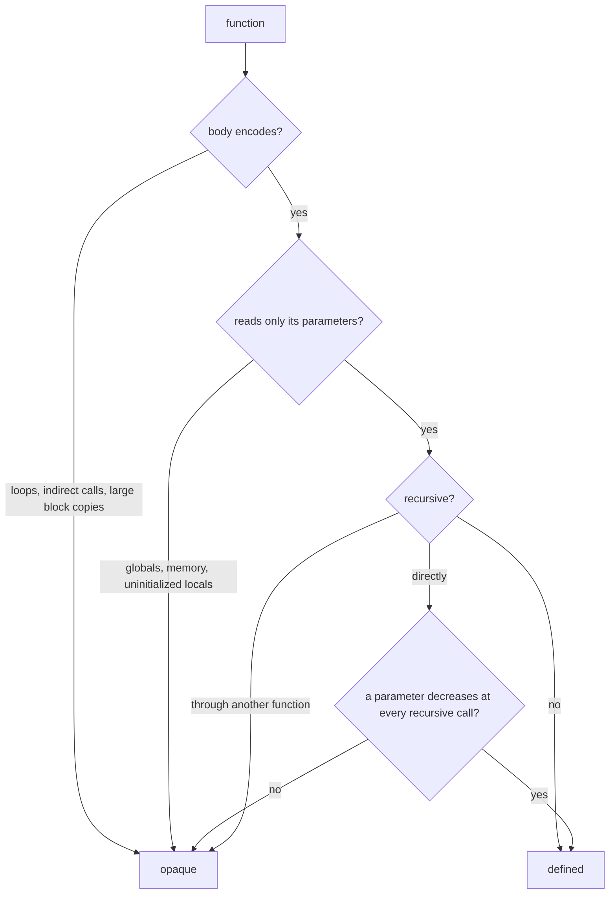
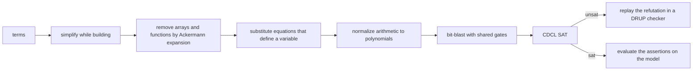

# Proofs

Mettle carries a theorem prover and an SMT solver inside the compiler. A
`theorem` states a claim about your functions, a `prove` states one at a
point inside a function, a proof script guides the prover, and the build
fails when a proof does not go through. Claims range over integers, pointers
and memory, and IEEE floats. The same solver proves the optimizer's own
rewrites and checks your `rewrite` rules and the passes `--verify` watches,
loops and calls included.

```mettle
fn mul_by_shifts(x: uint64, c: uint64) -> uint64 {
    if (c == 0) { return 0; }
    var rest: uint64 = mul_by_shifts(x << 1, c >> 1);
    if ((c & 1) == 1) { return rest + x; }
    return rest;
}

theorem mul_splits_low_bit(x: uint64, c: uint64) {
    x * c == (x << 1) * (c >> 1) + x * (c & 1)
} by smt;

theorem mul_by_shifts_is_mul(x: uint64, c: uint64) {
    mul_by_shifts(x, c) == x * c
} proof {
    induction c;
    use mul_splits_low_bit(x, c);
    auto;
}
```

The second theorem says the shift-and-add multiplier a code generator would
emit computes `x * c` for every pair of 64-bit inputs. The proof takes 0.13
seconds.

## Theorems

```mettle
theorem name(parameters) where condition {
    claim
} by tactic;
```

The claim is a `bool` expression over the parameters. The `where` clause is
optional and restricts the parameters the claim has to hold for. A theorem
holds when, for every value of every parameter that satisfies `where`, the
claim evaluates to `true` without trapping.

A proof is either one tactic after `by` or a block of tactics after `proof`.
A theorem with neither is proved by `auto`.

The claim, the `where` clause and every expression a tactic names become
ordinary functions before type checking. They are type checked and lowered
like the rest of the program, and the prover reads the lowered IR. A theorem
therefore talks about the code the compiler generates, with the semantics the
compile-time interpreter gives it: integers are 64-bit values narrowed when
they are stored in a typed variable, shift counts are masked to 63, division
by zero traps and `INT64_MIN / -1` wraps.

Theorems are checked on every build, with or without `-O`. They are dropped
before code generation and cost nothing at run time.

## prove inside a function

`prove(condition)` states a fact at a point in a function body. The compiler
proves it holds on every path that reaches the call, for every value of the
function's parameters, and the call compiles to nothing:

```mettle
fn clamp_index(i: int64, n: int64) -> int64 {
    if (n <= 0) { return 0; }
    var j: int64 = i;
    if (j < 0) { j = 0; }
    if (j >= n) { j = n - 1; }
    prove(j >= 0 && j < n);
    return j;
}
```

A `prove` that does not hold stops the build with the parameter values that
break it:

```text
halve.mettle:3:10: error: prove in `halve` does not hold; it fails at x = 3
```

Each site is closed by `auto`, so calls are unfolded and induction is tried
the same way. A loop is read as running any number of times from any state:
on entry to a loop, every variable the loop writes may hold any value. A
`prove` inside or after a loop can rely on the loop's own test, on what the
loop leaves alone, and on the loop invariants it is given or finds. That
reading covers every run the program can make, so a proof under it holds for
the program.

## Loop invariants

`invariant(condition)` as the first statement of a loop body states a fact
that holds every time the loop's test is reached. The compiler proves it
holds when the loop is entered and that one pass through the body keeps it,
then assumes it wherever the loop's variables are arbitrary, so it is known
inside the body and after the loop:

```mettle
fn sum_below(n: uint64) -> uint64 {
    var total: uint64 = 0;
    var i: uint64 = 0;
    while (i < n) {
        invariant(i <= n && 2 * total == i * (i - 1));
        total = total + i;
        i = i + 1;
    }
    prove(2 * total == n * (n - 1));
    return total;
}
```

After the loop the prover knows `i <= n` from the invariant and `!(i < n)`
from the test, derives `i == n`, substitutes it, and the `prove` follows. An
invariant that the body breaks is reported with the values that break it:

```text
loop.mettle:5:18: error: invariant in `double_up` does not hold (the invariant after an iteration); it may fail at n = 4294967294
```

Simple invariants are found without being written. For every variable the
loop writes, the prover tries comparisons with `==`, and with signed and
unsigned `<=` and `>=`, against
zero, one, the parameters, the constants in the loop, each variable's value
on entry, and the other variables the loop writes. It drops every comparison
that fails on entry, then every one that some iteration breaks while the rest
hold, using each counterexample to drop several at once, until the remaining
set holds on entry and survives an iteration. That set is assumed at the
loop's test. Here it finds `i <= n`, and the exit test gives `i == n`:

```mettle
fn count_up(n: int64) -> int64 {
    if (n < 0) { return 0; }
    var i: int64 = 0;
    while (i < n) {
        i = i + 1;
    }
    prove(i == n);
    return i;
}
```

An invariant with arithmetic, such as `2 * total == i * (i - 1)`, still has
to be written.

## Memory

Loads and stores through pointers are read against one array of bytes indexed
by 64-bit address. A store of `n` bytes writes `n` bytes, little-endian; a load
reads them back and sign or zero extends by the pointer's type. Two pointers
may hold any addresses, so they may be equal or overlap by a few bytes, and a
fact that needs them apart has to follow from the code:

```mettle
fn apart(p: int64*, q: int64*) -> int64 {
    var gap: int64 = (int64)q - (int64)p;
    if (gap < 8 && gap > -8) { return 1; }
    *p = 1;
    *q = 2;
    prove(*p == 1);
    return *p;
}
```

With the test `p == q` in place of the gap, the prover finds the partial
overlap:

```text
alias.mettle:5:10: error: prove in `overwrite` does not hold; it fails at p = 7, q = 6
```

A load or store through address zero traps, and so does one through any
address the program does not own, which the prover does not know and treats as
a fixed unknown set. A `prove` after an access may therefore assume the access
succeeded. A loop that stores, and a call to a function that may store, leave
every byte unknown afterward; a loop that only reads and a callee that only
reads keep memory as it was. A loop invariant can restore what a storing loop
keeps:

```mettle
fn clear_tail(a: int64*, n: int64) -> int64 {
    if (n > 1000) { return 0; }
    a[0] = 5;
    var i: int64 = 1;
    while (i < n) {
        invariant(a[0] == 5 && i >= 1 && i <= 1000);
        a[i] = 0;
        i = i + 1;
    }
    prove(a[0] == 5);
    return a[0];
}
```

Without the bound on `n`, `a + 8 * i` wraps around to `a` at `i = 2^61` and the
claim is false.

A local whose address is taken, and every array or struct local, lives in its
own stretch of that memory. Locals never overlap each other or address zero,
and an access at a fixed offset inside one never traps. A call keeps the bytes
of a local whose address the function only loads, stores, offsets and
compares; passing the address to a call, storing it, returning it or doing
other arithmetic with it lets any call change the local. Such a local is also
apart from every access through a pointer that was not computed from a
local's address, so a store through a parameter leaves it alone; a program
that reaches a local through any other pointer has a memory error.

Assigning one struct to another copies its bytes, up to 256 bytes. A struct
or `string` parameter is the address of the caller's copy; a `string` is its
16-byte record of data pointer and length.

Each global variable has its own stretch of memory, apart from the locals and
the other globals. Reading or writing it, or taking its address, is a load or
a store there. A call to a function that writes a global, or that the prover
cannot see into, leaves globals unknown afterward, and a pointer parameter may
point at a global. A call to a function without a body, such as `println`,
returns an unknown value, may trap, and leaves every byte unknown except the
locals whose address never reached a call. A string literal is a fixed unknown
address.

## How the prover sees a function

A call stays a call until a tactic unfolds it. Unfolding replaces the call
with the callee's body, which may itself contain calls. A function can be
unfolded when the prover can give it a definition:



The decrease is proved by the solver, in the signed or unsigned order of the
parameter's type. Both orders are well founded on a fixed-width integer, so a
definition with a decreasing parameter terminates and its equation is sound to
use. An opaque function can still appear in a theorem. The prover knows
nothing about it except that equal arguments give equal results.

When a proof fails, the error lists every function the proof touched that has
no definition, with the reason.

## Tactics

A proof works on a list of goals. Each goal has hypotheses and a conclusion,
all over the theorem's parameters. Tactics act on the first goal.

- `smt` closes the goal if the solver proves the hypotheses imply the
  conclusion.
- `auto` unfolds defined functions that do not recurse, tries `smt`, then
  unfolds recursive functions one level and tries again. If that fails and the
  goal calls a recursive function whose decreasing argument mentions a
  parameter, it tries induction on that parameter.
- `unfold f, g` replaces every call to the named functions with their bodies,
  one level. With no names it unfolds every defined function.
- `induction n` adds the strong induction hypothesis on parameter `n`: the
  claim holds for every smaller `n` in the order of `n`'s type, with every
  other parameter free.
- `cases e` splits the goal in two, one with `e` as a hypothesis and one with
  `!e`.
- `assert e` makes `e` the next goal and adds it as a hypothesis to the goal
  after it.
- `use t(a, b)` adds an earlier proved theorem `t`, instantiated at the given
  arguments, as a hypothesis.
- `rewrite t(a, b)` takes an earlier proved theorem whose claim is an
  equation, instantiates it, and replaces its left side with its right side
  in the goal, or the right with the left when only the right occurs. When
  `t` has a `where` clause, the instantiated clause becomes the next goal.
- `split` turns a goal `a && b` into two goals.
- `simp` rewrites the goal into the normal form the solver uses.
- `show` prints the goals.

An induction hypothesis is used by `smt` and `auto` through its calls: every
call in the goal that matches a call in the hypothesis yields an instance. In
`mul_by_shifts_is_mul`, unfolding `mul_by_shifts(x, c)` exposes
`mul_by_shifts(x << 1, c >> 1)`, and the hypothesis instantiated there states
that call equals `(x << 1) * (c >> 1)`.

A proof that ends with goals left is an error, and so is a tactic that fails.

## Failed proofs

A failing `smt` or `auto` reports the goal it could not close and, when the
solver found one, the parameter values where the goal fails:

```text
abs.mettle:8:6: error: theorem `abs_is_nonnegative`: auto could not close the goal; with the definitions unfolded so far it fails at x = -2147483648
  remaining goals:
    goal 1 of 1 (x: int32)
      |- (0 <= ((x < 0) ? (int32)(-x) : x))
```

The values are exact when every function in the goal has been unfolded. A
call that is still folded can make the failure spurious, which is why the
message says "with the definitions unfolded so far".

## mettle prove

```bash
mettle prove program.mettle
mettle prove program.mettle --goals
mettle prove program.mettle --interactive gauss
```

`mettle prove` checks every theorem and prints one line per theorem with the
tactics run, the solver calls made and the time taken. `--goals` prints the
goals after every tactic. `--interactive` runs the named theorem's script and
then reads more tactics from standard input, printing the goals after each one,
until no goals remain or a blank line ends the session.

## The solver

The solver decides formulas over Booleans, bit-vectors up to 256 bits, arrays
and uninterpreted functions:



Terms are hash-consed, so a subterm built twice is one node. The simplifier
folds constants, applies Boolean and bit-vector identities, and turns division
by a power of two into shifts and masks.

The normalizer rewrites sums, differences, negations, shifts by constants and
products into polynomials over Z/2^w with sorted monomials. An equation
becomes one polynomial set to zero, with negative terms moved to the other
side. Reassociated and strength-reduced arithmetic meets in one form, and the
SAT solver never sees it. Inside a negated equation it also writes `v` as
`2^k * (v >> k) + (v & (2^k - 1))` when both pieces appear, which is how
`mul_splits_low_bit` is proved without a multiplier circuit.

The SAT solver eliminates variables by bounded resolution before the search,
then uses two watched literals with blocking literals, VSIDS decisions with
phase saving, first-UIP learning with recursive minimization, restarts driven
by the moving average of clause quality, and clause deletion by literal block
distance. A satisfying assignment is extended back over the eliminated
variables from the clauses they removed.

Every `unsat` answer comes with a refutation: each learned clause, each
resolvent from variable elimination and each fact derived at the top level
is logged with the clauses it was derived from. An independent checker that
shares no code with the SAT solver walks back from the final conflict, marks
the clauses it depends on, and confirms each marked clause by unit
propagation over those clauses alone. A refutation that fails the check
turns the answer into `unknown`. Every `sat` answer is checked by evaluating the
original assertions on the model. A wrong answer from the search therefore
cannot reach a proof. The bit-blaster, the simplifier and the normalizer are
checked by a differential fuzzer that compares each against the evaluator.

Quantified formulas are treated as opaque atoms. That is sound for proofs,
and a `sat` answer on a formula that contained one is reported as `unknown`.

## Floating point

`float32` and `float64` values are their IEEE 754 bits. Addition,
subtraction, multiplication, division, square root, comparison, negation and
the
conversions to and from integers and between the two widths are built as
bit-vector circuits in `src/proof/smt_fp.c` and round to nearest, ties to
even. Subnormals, signed zeros and infinities follow the standard, and a
conversion to an integer that is out of range or not a number gives
`INT64_MIN` as the interpreter does. An operation that produces NaN gives
some quiet NaN chosen by an unknown function of its operands, since the
payload x86 keeps depends on operand order. When two versions of a function
that returns a float are compared, for a rewrite rule or a pass, two NaN
results count as equal. The circuits are checked against the host's SSE
arithmetic on edge cases and random operands.

A claim about floats has to hold for NaN too:

```text
float.mettle:4:10: error: prove in `trunc_in_range` does not hold; it fails at x = nan
```

The guard `x < 0.0 || x > 100.0` is false for NaN, so NaN reaches the
conversion and becomes `INT64_MIN`. Half-precision values are not modeled.
Claims that combine a square root with a product, such as
`sqrt(x * x) == x`, exceed the solver's search limit.

## mettle smt

```bash
mettle smt problem.smt2
mettle smt --stats problem.smt2
```

`mettle smt` reads SMT-LIB 2: `declare-const`, `declare-fun`, `define-fun`,
`assert`, `push`, `pop`, `check-sat`, `get-model`, `get-value` and `echo`, with
the `QF_ABV` operators, indexed operators, `let` and `ite`. It also reads
`QF_FP` over `Float16`, `Float32` and `Float64` with the rounding mode `RNE`:
`fp`, the special constants, `fp.add`, `fp.sub`, `fp.mul`, `fp.div`,
`fp.sqrt`, `fp.abs`, `fp.neg`, the comparisons, the classification
predicates and `to_fp`. `--stats` prints
the term, gate, clause and conflict counts and the time spent blasting,
searching and checking. `--no-certify` skips the refutation check and
`--no-normalize` skips the polynomial normal form. A file ending in `.cnf`,
or any file with `--dimacs`, is read as DIMACS CNF and handed to the SAT
solver directly, with the same refutation check.

## The compiler proves its own rewrites

`mettle prove-compiler` proves every row of the optimizer's identity table in
`src/ir/optimizer/ir_optimize_rewrite.c`, for signed and unsigned operands, in
both operand orders where a row is commutative, and for every shift a
power-of-two pattern allows:

```text
  proved   x>=0 % 2^k  =>  x & (2^k - 1)
  proved   x || c!=0  =>  1              (both orders)
30 identities, 570 obligations over 64-bit signed and unsigned operands, 0 refuted, 15.0 ms
```

A row the solver refutes is printed with the input that breaks it.

It then runs the x86-64 backend's own division lowering,
`mir_emit_const_divmod` in `src/codegen/binary/mir_lower.c`, signed and
unsigned, quotient and remainder, for every divisor from 3 to 100, every
power of two up to 2^62, `2^k - 1` and `2^k + 1`, the powers of ten, the
negations of all of those, and the extremes. It executes the MIR that comes
out and proves each sequence computes the IR's `/` or `%` for every 64-bit
dividend:

```text
1230 constant divisions lowered by mir_emit_const_divmod: 1230 proved, 0 refuted, 0 not decided, 14168.3 ms
```

`METTLE_PROVE_DIVISORS=N` extends the dense range to `N`.

A power-of-two sequence is proved by the bit-vector solver. A magic-number
sequence, a multiply-high followed by shifts and corrections, defeats
bit-blasting: the solver does not finish `x / 10` in 100 seconds, even for
32-bit dividends. Those go to a linear integer engine instead. Each
multiply-high and shift becomes a quotient variable with a bounded
remainder, each addition gets a wrap variable that is enumerated over the
values its operand ranges allow, and a sign extraction is split into its two
cases. A wrong result then means the claimed quotient `q` and the true one,
fixed by `0 <= x - d q < |d|` with the sign of `x`, differ by at least one. The
engine substitutes away every equation with a unit coefficient, eliminates the
remaining variables by Fourier-Motzkin with exact big integers, and tightens
each inequality to integers by its coefficients' greatest common divisor. An
empty system is the proof.

When the linear engine cannot close a case, the bit-vector solver takes it and
looks for a counterexample. With the final shift of the unsigned magic
sequence off by one, every affected divisor is refuted with a dividend:

```text
  REFUTED  x / 10 (unsigned): wrong at x = 882705526964617208
```

With the rounding bias removed from the signed power-of-two sequence, 250
cases are refuted the same way.

Last, it proves the backend's strength-reduction classifier in
`src/codegen/binary/strength_rules.c`: every multiplication by `2^k`,
`2^k + 1` or `2^k - 1` it rewrites into a shift, a shift and add, or a shift
and subtract equals the multiplication, signed and unsigned.

[Rewrite rules](rewrite-rules.md) are proved for every input before the
compiler applies them, and fall back to generated inputs only when the solver
cannot model a side, such as one that makes an indirect call. A rule can also
carry a `proof` block of tactics, which makes the optimizer apply an
identity that only an induction establishes.
[Translation validation](translation-validation.md) proves each pass
application on a loop-free integer function before it runs inputs.
