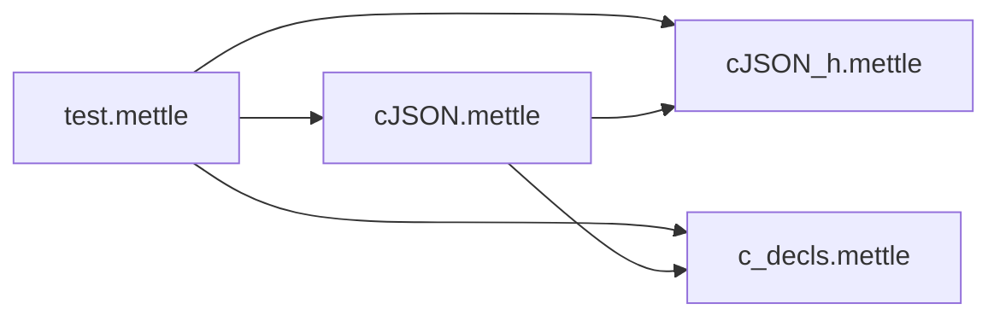

# Translating C

`mettle translate` reads C99 source and writes Mettle source that builds with
`mettle --build` and behaves the same.

```bash
mettle translate queens.c -o queens.mettle
mettle --build queens.mettle
```

Given several `.c` files, it writes a program of modules into the directory
`-o` names, or beside the first file without `-o`:

```bash
mettle translate cJSON.c test.c -o out
mettle --build out/test.mettle
```



- Each `.c` file becomes a module of the same name. Its functions and globals
  are exported unless C made them `static`.
- Each project header becomes a module named after it, so `cJSON.h` becomes
  `cJSON_h.mettle`. It holds the header's structs, enum constants and macro
  constants, once, however many files include it.
- `c_decls.mettle` holds the C library functions the program calls without a
  Mettle mapping and the C library structs it uses.
- A module imports the modules whose names it uses. A function declared in one
  file and defined in another is called directly, and a global defined in
  several files as a tentative definition is defined once.
- When globals need code to set them up, each module gets an `init_<module>`
  function and `main` calls them first.

## Options

| Flag | Effect |
|---|---|
| `-o <path>` | Output file for one input, output directory for several |
| `-I <dir>` | Add an include directory |
| `-D <name>[=value]`, `-U <name>` | Define or undefine a macro |
| `--target <t>` | `windows-x64`, `linux-x64`, `linux-arm64` or `macos-arm64` |
| `--expand-macros` | Expand every macro instead of keeping constants by name |
| `--no-comments` | Drop the C comments |
| `--c-include <dir>` | Use other C library headers |
| `-E` | Print the preprocessed C and stop |

The target fixes the sizes C leaves open: `long` is 32 bits on Windows and 64
on Linux and macOS, and plain `char` is unsigned on Linux AArch64. The output
is written for one target.

## What a C program becomes

```c
#define SIZE 8
static int board[SIZE];

static int safe(int row, int col) {
  for (int i = 0; i < row; i++) {
    int c = board[i];
    if (c == col || abs(c - col) == row - i)
      return 0;
  }
  return 1;
}
```

```mettle
const SIZE: int32 = 8;

var board: int32[8];

fn safe(row: int32, col: int32) -> int32 {
  for i: int32 in 0..row {
    var c: int32 = board[i];
    if (c == col || abs(c - col) == row - i) {
      return 0;
    }
  }
  return 1;
}
```

- C types map to their sizes: `int` to `int32`, `unsigned char` to `uint8`,
  `void *` to `rawptr`, a pointer to an incomplete struct to `rawptr`.
- An object-like macro whose every use is the same constant becomes a `const`.
  Other macros are expanded where they are used.
- A `for` loop over a local counter with a bound that does not change becomes
  a range loop. Other loops become `while`.
- `static` functions and globals stay private to the module. The rest are
  exported when there is more than one module.
- A local that C reads before writing gets `= 0`. Other locals are declared
  bare.

## Conversions

Mettle widens implicitly but does not promote: `uint8 + uint8` is a `uint8`
add. The translator writes the casts C's promotion rules imply, and only
those. `a + b` on two `unsigned char` values becomes `(int32)a + b`. When the
result is stored back into the narrow type, as in `c += 2` or `c = c + 1`,
the add is done in the narrow type because the truncated result is the same.
Shifts keep the cast, because an 8-bit shift in Mettle wraps its count.

## Control flow

`break` and `continue` keep their C targets. A Mettle `switch` ends each case
without a `break`, so a case that falls into the next ends in
`fallthrough;`. A `for` loop becomes a `while` with its step at the end of the
body. A `continue` in it repeats the step first when the step is a plain
increment or assignment and appears at most four times. Otherwise the body sits
in an inner loop the `continue` breaks out of, so the step runs once.

A `goto` to a label later in the same block becomes a `break` out of a labeled
loop that ends at the label. A `goto` back to an earlier label becomes a
`continue` of a labeled loop that starts there:

```c
  if (!item) goto fail;
  copy = new_item();
  if (!copy) goto fail;
  return copy;
fail:
  release(copy);
  return NULL;
```

```mettle
  fail: while (true) {
    if (item == 0) {
      break;
    }
    copy = new_item();
    if (copy == 0) {
      break;
    }
    return copy;
  }
  release(copy);
  return 0;
```

A local declared inside the jumped-over statements and used after the label is
declared before the loop. A function whose gotos enter a loop or a block from
outside is rebuilt from its control flow graph: loops become labeled
`while (true)` loops, a block that several jumps reach becomes a labeled block
they break out of, and branches become `if` and `switch`. A graph with a loop
entered in more than one place, such as Duff's device, becomes a loop over a
state variable that names the next block.

## Variadic functions

A call to a C variadic function passes the arguments as written:

```mettle
extern fn printf(format: int8*, ..) -> int32;

printf("%d %s %.2f\n", count, name, ratio);
```

The compiler applies C's default promotions and the platform convention. A
variadic function the program defines takes `name: ..`, and `std/c` reads it:

```mettle
import "std/c" as libc;

fn log_line(format: int8*, va: ..) -> int32 {
  var ap: libc.VaList = libc.va_start(va);
  return vfprintf(libc.stderr(), format, libc.va_native(&ap));
}
```

`libc.va_next(&ap)` reads the next integer or pointer and
`libc.va_double(&ap)` the next floating value. `libc.va_native(&ap)` is the
platform `va_list` that C library functions take. A struct passed through
`...` to a function the program defines travels by address, and `va_arg`
copies it out.

A pointer to a C variadic function has a type that ends in `..`:

```mettle
var emit: fn(rawptr, int8*, ..) -> int32 = &fprintf;
emit(libc.stderr(), "%d\n", code);
```

## Arrays whose size is set at run time

A variable-length array is an element pointer to storage from
`libc.vla_alloc`, freed by a `defer` at the end of its block. Indexing a row
multiplies by the row length, `sizeof` multiplies the lengths, and pointer
arithmetic on a pointer to a row steps whole rows. C reads a length once, where
the array is declared, so a length the function later changes is copied into a
local such as `wide_len1` first.

## Wide strings

`wchar_t` is `uint16` on Windows and `int32` elsewhere. A wide literal becomes
a module array of its units, named after its text when the text is a word:

```mettle
var wide_hello: uint16[6] = ['h', 'e', 'l', 'l', 'o', 0];
```

The `wcs` and `wmem` functions in `wchar.h` come from the owned runtime.

## The C library

The headers in `stdlib/c/include` declare what the owned runtime provides:
stdio, stdlib, string, ctype, time, setjmp, signal and locale. The
double-precision functions in `math.h` call `std/math`. `stdin`, `stdout` and
`stderr` become `libc.stdin()` and the like.

## What does not translate

- Inline assembly.
- `_Complex` and `long double` beyond 64-bit precision. `long double` is
  treated as `double`, with a warning.
- Thread-local storage. `_Thread_local` becomes an ordinary global, with a
  warning.
- A struct passed by value through `...` to a C library function.
- The address of a variadic function the program defines, stored in a pointer
  to a variadic function. That function takes Mettle's `name: ..` arguments,
  and the pointer type calls with C's convention, so the compiler rejects the
  assignment.
