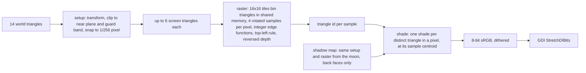

# cube

A steel cube on wet asphalt under a low moon, drawn by a rasterizer written in
Mettle kernels and run on an NVIDIA GPU. No Direct3D, OpenGL or Vulkan. Win32
opens the window and GDI copies the finished frame into it.

```bash
examples\cube\build.bat
examples\cube\cube.exe
```

One `mettle --build` compiles the kernels in [`raster.mettle`](raster.mettle)
to PTX and builds them into the executable with the host in
[`cube.mettle`](cube.mettle).

## Controls

| Input | Action |
|---|---|
| Right drag | look |
| Left drag | orbit the cube |
| W A S D | move |
| E or Space, Q or C | rise, sink |
| Shift | move faster |
| Wheel | push forward, or change orbit distance |
| Esc | quit |

## The frame



The shadow map is drawn once at startup, since nothing in the scene moves. Each
frame runs three kernels.

The shader reconstructs each sample's position by intersecting its camera ray
with the triangle's plane, so attributes are exact without interpolation. It
lights with a GGX moon, a soft shadow whose penumbra grows with the distance to
the blocker, the cube's exact cosine-weighted occlusion of the sky on the
ground, mirror-like wet patches that reflect the sky and the cube, and height
fog lit by a sodium glow on the horizon. Procedural detail drops octaves the
pixel cannot hold, so the asphalt does not shimmer at a distance. Each distinct
surface in a pixel is tone mapped before the samples are averaged.
