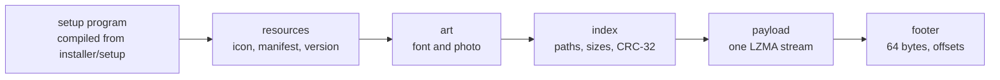
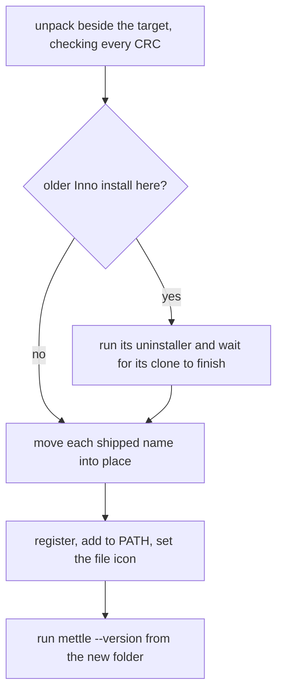

# Windows installer

`Mettle-Setup.exe` is a Mettle program. It draws its own window, unpacks its own payload with an LZMA decoder written in Mettle, and needs no other tools to run.

## Build

Build the compiler first, then pack:

```bat
build.bat gcc
python -m pip install pillow fonttools brotli
python installer\pack.py
```

The result is `installer\out\Mettle-Setup.exe`. `--fast` compresses less, for testing. `--compiler` names a different compiler to build the setup program with.

## How the file is laid out



`pack.py` adds the resources, because the compiler's PE writer has no resource section. An installed `uninstall.exe` is the same file with the payload left out.

## What it does



- A failure while moving files puts the old ones back. Cancelling removes the unpacked copy and changes nothing else.
- It only moves and deletes the names it ships. A file you added to the folder stays through an upgrade and an uninstall.
- It refuses a folder that holds other files and no Mettle install.
- Choosing Everyone installs to Program Files and relaunches through the Windows permission prompt.

## Options

```text
Mettle-Setup.exe [--silent] [--dir <folder>] [--everyone | --just-me] [--no-path] [--no-association]
uninstall.exe [--silent] [--everyone]
```

`--silent` shows no window, prints to the console it was started from and exits 0 on success. `--everyone` with `--silent` needs an elevated shell.

## Test

```bat
python installer\test_setup.py
python installer\test_setup.py --window
```

The first run needs no display. It renders every page at three scales, installs, upgrades, refuses a bad folder, takes over an older install and uninstalls. Every registry write goes under `HKCU\Software\MettleSetupTest`, through `--registry-root`, and is removed at the end. `--window` also drives the real window on your screen: the picker, cancelling mid-install, and removal.

`--render <page> <file.bmp> [--scale <percent>]` writes one page to a file. The pages are `ready`, `upgrade`, `everyone`, `work`, `done`, `failed`, `remove`, `removing` and `removed`.

## Other ways to install

`install.ps1` at the repository root downloads the latest release zip to `%LOCALAPPDATA%\Mettle`. `mettle-build.bat` forwards to `mettle --build`.
