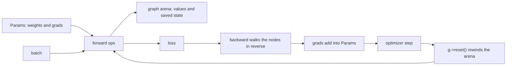

# mmll

Tensors, reverse-mode gradients, layers, optimizers and safetensors checkpoints,
written in Mettle. It runs in float32 on every CPU core or on an NVIDIA GPU, and
the two give the same numbers.

```mettle
import "mmll";

fn main() -> int32 {
  var rng: Rng = rng_new(1);
  var ps: Params* = params_new();
  var hidden: Linear = make_linear(ps, "hidden", 2, 8, true, &rng);
  var out: Linear = make_linear(ps, "out", 8, 1, true, &rng);
  var opt: Optimizer* = adam(ps, 0.05, 0.9, 0.999, 1.0e-8, 0.0);
  var g: Graph* = graph_new();
  var inputs: float32[8] = [0.0, 0.0, 0.0, 1.0, 1.0, 0.0, 1.0, 1.0];
  var targets: float32[4] = [0.0, 1.0, 1.0, 0.0];
  for step in 0..300 {
    g->reset();
    var x: Var = g->values(inputs, shape(4, 2));
    var y: Var = g->values(targets, shape(4, 1));
    var loss: Var = bce_with_logits(out.forward(hidden.forward(x).tanh()), y);
    loss.backward();
    opt->step();
    opt->zero_grad();
  }
  return 0;
}
```

## A training step



Every op writes its output into the graph's arena and appends a node. `backward`
walks from the loss to the inputs and adds each gradient into the inputs that
need one. A parameter's gradient lands in `Param.grad` and stays there until
`zero_grad`. After the first step the loop allocates nothing: `g->reset()`
rewinds the arena, and it keeps one block the size of the largest step so far.
A `Var` and what it points at are valid until the next reset.

Set `g->record = false` to evaluate without gradient state, and
`g->training = false` to turn dropout off and run batch norm on its running
statistics.

## On the GPU

```mettle
import "mmll";
import "mmll/gpu";

var dev: Device* = gpu_device();
ps->to_device(dev);
var g: Graph* = graph_on(dev);
```

From there the program is the same. Every op has a kernel written in Mettle in
`gpu.mettle`, and `mettle --build` compiles them into the executable. Running it
needs the NVIDIA driver and nothing from the CUDA toolkit. A program that never
imports `mmll/gpu` has no GPU code in it.

- The parameters live in one device buffer and their gradients in another, so
  `zero_grad` is one fill and the optimizer updates every weight in two
  launches. `opt->clip_at(max_norm)` clips inside the step without waiting for
  the host; `opt->last_norm()` reads the norm back when asked.
- `v.item()`, `v.fetch()` and `v.fetch_grad()` copy to the host. `v.data()` is
  a device address.
- `save_safetensors` reads the weights back from the device and
  `load_safetensors` writes them to it.
- Attention with heads 32, 64 or 128 wide runs fused: the time by time
  probabilities are never stored, and backward recomputes them from each row's
  log-sum-exp. Other widths use batched matrix products.
- `m.generate` keeps its key and value cache on the device.
- Dropout draws the same mask on both devices, so a step on the GPU matches the
  same step on the CPU.

## Operations

Methods on `Var`:

- `add`, `sub`, `mul`, `div`, broadcasting the way NumPy does
- `neg`, `exp`, `log`, `sqrt`, `tanh`, `sigmoid`, `relu`, `leaky_relu(slope)`,
  `gelu`, `gelu_tanh`, `silu`, `softplus`, `abs`, `square`, `clamp(lo, hi)`,
  `shift(c)`, `scale(c)`, `pow(p)`
- `sum()`, `mean()`, `sum_axis(axis, keep)`, `mean_axis`, `max_axis`
- `reshape(shape)`, `view(dims...)` with `-1` for one dimension, `flatten(from)`,
  `transpose(a, b)`, `t()`, `slice(axis, start, length)`
- `matmul(b)` and `matmul_t(b)` for a times b transposed, batched over the
  leading dimensions
- `softmax()`, `log_softmax()`, `causal_softmax()` over the last axis
- `backward()`, `backward_with(seed)`, `value()`, `grad()`, `item()`

Functions:

- `concat(a, b, axis)`, `linear(x, weight, bias)` with the weight stored
  `[out, in]`, `linear_nobias(x, weight)`
- `cross_entropy(logits, targets, smoothing)`, where a negative target is skipped,
  `mse_loss(a, b)`, `bce_with_logits(logits, targets)`
- `layer_norm(x, weight, bias, eps)`, `rms_norm(x, weight, eps)`,
  `batch_norm(x, weight, bias, running_mean, running_var, momentum, eps)`
- `self_attention(qkv, heads, causal, dropout)` takes queries, keys and values
  packed as `[batch, time, 3 * width]` and returns `[batch, time, width]`. Each
  batch and head runs as one task in cache. `attention_composed` builds the same
  thing from `matmul_t`, `causal_softmax` and `matmul`.
- `conv2d(x, weight, bias, stride, pad)`, `conv2d_nobias`, `conv2d_dilated`,
  `max_pool2d(x, size, stride, pad)`, `avg_pool2d`, `global_avg_pool`
- `dropout(x, p)`, `embedding(table, ids, dims...)`, `gather_rows(table, ids, shape)`
- `gradcheck(build, inputs, count, eps, tolerance)` compares a function's
  gradients against central differences

## Layers

Each constructor registers its parameters under a dotted name and initializes
them as PyTorch does. Weights with two or more dimensions get weight decay;
biases and norm scales do not.

- `make_linear(ps, name, in, out, bias, rng)`, then `l.forward(x)`
- `make_embedding(ps, name, count, width, rng)`, then `e.lookup(g, ids, dims...)`
- `make_layer_norm(ps, name, width, eps)` and `make_rms_norm(ps, name, width, eps)`
- `make_conv2d(ps, name, in, out, size, stride, pad, bias, rng)`
- `make_batch_norm(ps, name, channels)`
- `make_mlp(ps, name, width, hidden, dropout, rng)`
- `make_attention(ps, name, width, heads, causal, dropout, rng)`
- `make_block(ps, name, width, heads, dropout, rng)`, a pre-norm transformer block
- `make_gpt(ps, config, rng)`, then `m.forward(g, ids, batch, time)` or
  `m.loss(g, ids, targets, batch, time)`

Every layer but the embedding has `forward(x)`.

`make_gpt` builds a GPT-2 decoder: token and position embeddings, pre-norm
blocks, a final norm and an output head that can share the token table. It uses
GPT-2's initialization. `m.step(g, cache, token)` runs one token through a
key and value cache, and `m.generate(g, prompt, length, out, count, temperature,
top_k, rng)` samples from it.

`init_normal`, `init_uniform`, `init_constant`, `init_xavier_uniform`,
`init_kaiming_normal` and `init_kaiming_uniform` set a parameter again.
`ps->freeze(prefix)` and `ps->unfreeze(prefix)` stop and restart training on
every parameter whose name starts with `prefix`.

## Optimizers

`sgd(ps, lr, momentum, weight_decay, nesterov)`,
`adam(ps, lr, beta1, beta2, eps, weight_decay)` and
`adamw(ps, lr, beta1, beta2, eps, weight_decay)`, then `opt->step()`,
`opt->zero_grad()` and `opt->set_lr(lr)`. SGD and Adam add the decay to the
gradient; AdamW shrinks the weights apart from it, as in PyTorch.

`clip_grad_norm(ps, max_norm)` returns the norm before clipping.
`lr_cosine(step, warmup, total, peak, floor)`, `lr_linear` and
`lr_step(step, every, gamma, base)` give a rate for a step.

## Data

- `read_file(path)` and `write_file(path, data, length)` return a `Result`.
- `idx_images(path)` and `idx_labels(path)` read the MNIST format. Images come
  back as `[count, 1, rows, cols]` scaled to 0..1.
- `make_batches(count, size, shuffle, seed)` hands out shuffled indexes:
  `b->next()` gives the size of the next batch and 0 at the end of an epoch, and
  `b->take_rows(images, dst)` and `b->take_labels(labels, dst)` gather it.
- `byte_vocab(text)`, `v.encode(text, out)` and
  `sample_windows(tokens, count, batch, length, rng, x, y)` feed a language model.
- `count_correct(logits, labels)` and `argmax_rows(logits, out)`.

## Checkpoints

`save_safetensors(ps, path)` and `load_safetensors(ps, path, strict)` use the
safetensors format, so a model saved here loads in PyTorch and back. Loading
reads F32, F16, BF16 and F64; saving writes F32. `safetensors_open(path)`
returns a `SafeFile` for looking through any file by name, shape and type.
Batch norm's running statistics are saved with the weights.

## Same bits on any number of cores

One thread computes each output element, in a fixed order. Sums across threads
add fixed blocks in a fixed order. A dropout mask is a hash of a key and the
element's index, so backward recomputes it. Five training steps of a GPT with
dropout give the same loss bits and weight bits on 1, 3, 8 and 20 threads.
`METTLE_PARALLEL_THREADS` sets the count.

## Checked

`mettle test` runs every op's gradient against central differences in the
compiler's interpreter, which also fails a test that leaks.

A GPT and a CNN built here and in PyTorch from the same safetensors file:

- GPT: loss equal to 7 digits, every gradient within 7e-7 relative, one AdamW
  step within 6e-8, cached generation within 6e-8 of the full forward pass
- CNN with batch norm, pooling and label smoothing: every gradient within 3e-5
  relative, running statistics within 5e-8, one Nesterov SGD step within 6e-8,
  evaluation logits within 5e-8

`examples/gpu_check.mettle` runs 67 ops on the GPU and on the CPU from the same
inputs and compares values and input gradients. All agree within 3e-6 relative;
a float32 sum of 70,000 values on the GPU against the CPU's float64 one is
within 1e-4. Eight AdamW steps of a GPT with dropout and clipping give the same
loss to 1e-6 on both, and forty cached generation steps give logits within 3e-7
and the same greedy tokens.

## Speed

Intel Core i7-12700K, 20 threads, against PyTorch 2.8 on the same CPU:

- GPT, width 192, 4 layers, context 128, batch 32: 23,000 to 24,000 tokens per
  second, PyTorch 13,600
- CNN, two convolutions on 28 by 28 images, batch 64: 8,000 images per second,
  PyTorch 8,350
- Matrix multiply, 2048 cubed: 780 to 800 GFLOPS, PyTorch with MKL 810

GeForce RTX 5060 Ti against PyTorch 2.8 with CUDA, both in float32, the same
model and optimizer:

- GPT, width 192, 4 layers, context 128, batch 32: 430,000 tokens per second,
  PyTorch 213,000
- GPT, width 384, 4 layers, context 256, batch 32: 161,000 tokens per second,
  PyTorch 114,000
- Matrix multiply, 2048 cubed: 12.4 TFLOPS, PyTorch with cuBLAS 15.5

`g->profile(true)` and `g->profile_report()` give the time spent in each op,
forward and backward. On a GPU the profile waits for each op to finish.

## Examples

- `examples/xor.mettle` is the program above.
- `examples/charlm.mettle` trains a GPT on the characters of any text file and
  samples from it; a last argument of `gpu` trains it on the GPU.
- `examples/gpu_check.mettle` compares every op on the GPU with the CPU.
- `examples/shapes.mettle` renders 14,000 images of rings, squares, triangles
  and crosses, trains a CNN to 99.95% on the held-out set and reloads its
  checkpoint.
- `examples/mnist.mettle` trains a CNN on the four MNIST IDX files.
